# robot-nav-simulator

A lightweight 2D autonomous mobile robot navigation simulator built with C++17 and Python,
featuring A* path planning, occupancy-grid mapping, collision detection, trajectory
visualization, and performance analysis. Runs on an ordinary laptop: no robot hardware,
no ROS, no GPU. An optional ROS 2 package publishes the same simulation to RViz2.

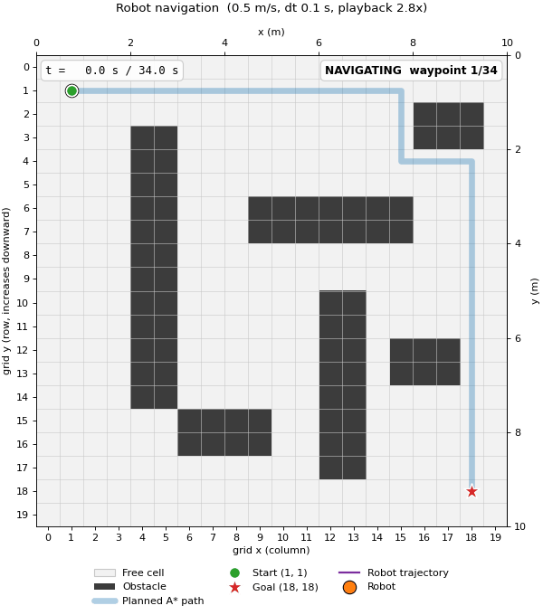

| Planned path | Planned path vs. robot trajectory |
|---|---|
| 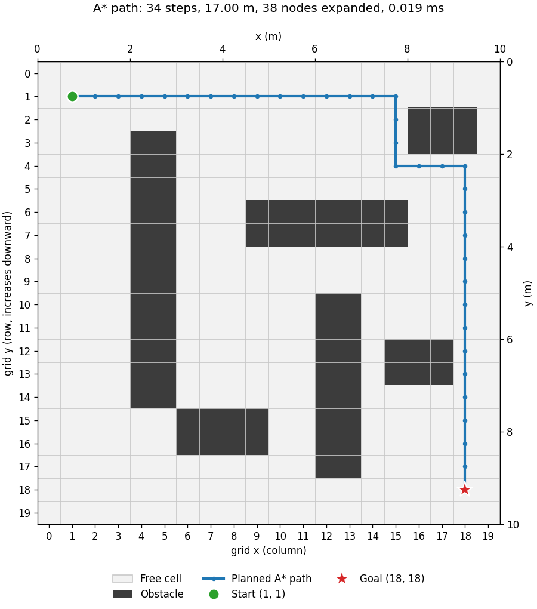 | 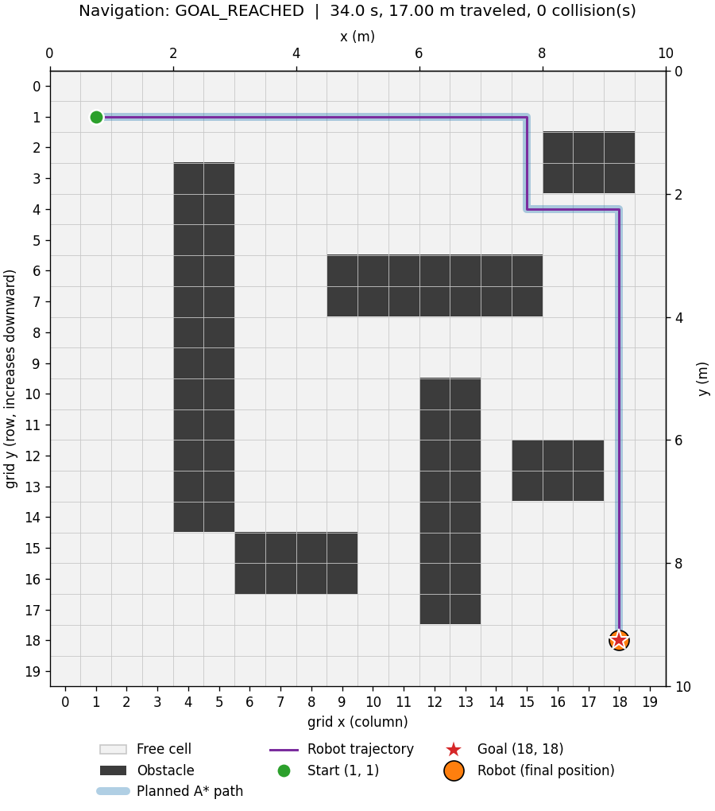 |

## Motivation

Planning a collision-free route and following it is the core loop of every mobile
robot. This project builds that loop from first principles, small enough to read in an
afternoon:

- an environment model (occupancy grid);
- a graph search (A*, written from scratch);
- a motion model with collision checking;
- simulation with metrics;
- visualization.

It is verified rather than just demonstrated: A* is checked against an independent BFS,
the motion is checked against its physical invariants, and every performance number
comes from a reproducible benchmark.

## Features

- Occupancy-grid maps loaded from CSV, with validation of every input (missing/empty
  files, non-rectangular grids, unsupported cell values, invalid dimensions).
- A* path planner written from scratch: 4-connected grid, uniform step cost,
  Manhattan heuristic, `std::priority_queue` with lazy deletion, **deterministic
  tie-breaking**. Optimized for speed (1 byte of state per cell, a two-bucket open set,
  reusable buffers) while giving bit-identical results to the straightforward version.
- Optional 8-connected planning (`--connectivity 8`): diagonal moves with cost √2,
  octile-distance heuristic, no cutting across obstacle corners. Costs are kept exact as
  integer pairs (`a + b·√2`), so optimality is verified exactly against a reference
  Dijkstra search. On the benchmark maps the paths are 12–29 % shorter.
- Explicit planner status: `SUCCESS`, `NO_PATH`, `START_OUT_OF_BOUNDS`,
  `GOAL_OUT_OF_BOUNDS`, `START_OCCUPIED`, `GOAL_OCCUPIED`, `START_TOO_CLOSE_TO_OBSTACLE`,
  `GOAL_TOO_CLOSE_TO_OBSTACLE`. A failed plan never returns a fabricated path.
- Robot footprint (`--robot-radius`): the robot is a disc; obstacles are inflated by its
  radius for planning, and every simulated step is checked with an exact swept-disc test
  against the real map. A radius of 0 keeps the point robot, with byte-identical results.
- Planning metrics: time (steady clock, search only), expanded nodes, path length in
  steps and meters.
- Point-robot motion simulation: constant speed, fixed timestep, step clamped so the
  robot never overshoots a waypoint, time limit against endless runs.
- Differential-drive robot (`--robot-model diff-drive`): pose `(x, y, θ)` driven by linear
  and angular velocity with exact unicycle kinematics, a proportional heading controller
  with turn-rate limit, and a turn-then-drive waypoint follower that keeps the robot on
  the planned path. The trajectory, plots and animation show the heading.
- Simulated 2D LiDAR (`--lidar-beams N`): exact ray casting against the grid (cell-by-cell
  traversal, no sampling), one scan per timestep relative to the robot's heading, optional
  seeded range noise, the rays drawn in the animation and a scan snapshot figure.
- EKF localization (`--ekf`): noisy wheel odometry, an Extended Kalman Filter corrected
  by the LiDAR ranges on the known map (exact range Jacobians, outlier gate), and the
  estimated vs. true trajectory with error plots and 3σ bounds. Checked for statistical
  consistency (NEES) by Monte Carlo.
- Dynamic obstacles with replanning (`--dynamic-obstacles FILE`): moving obstacles,
  detection of a blocked path within the robot's sensing range, and A* replanning with
  the reused planner, plus waiting, backing off and a look-ahead gate. The robot
  reaches the goal in 98 % of 500 random scenarios, against 71 % without reacting.
  Collisions are exact, including contact between two samples.
- "Why NO_PATH?" (`ghost_experiment`): an exact solver for the smallest or most likely
  set of "ghost" cells (false obstacles) whose removal would let the disc robot reach
  its goal, plus a perception loop that re-senses only those cells. It recovered all
  300 ghost-caused failures with a median of 5 LiDAR beams, where clearing the map
  recovered half of them with about 6800.
- Grid alignment (`alignment_experiment`): a measurement of how the grid's rotation and
  sub-cell offset alone decide whether a doorway is passable (a 25 cm band of door
  widths for every rasterization rule), proven bounds, an alignment-robust planner on the
  LiDAR's own hit points (a 3 cm band), and a test that tells discretization artifacts
  from sensor ghosts. Grid-only recovery opened paths through walls in 72 of 180
  NO_PATH cases; the point-aware recovery in none.
- P vs. PID heading-control study (`heading_experiment`): a heading with motor lag and a
  disturbance, both controllers (PID with derivative on the measurement and anti-windup)
  in four scenarios, with overshoot, settling time, steady-state and tracking error and
  control effort, and plots. Validated against second-order control theory.
- Motion-time collision checking of every movement segment against the occupancy grid
  (point or disc robot).
- Navigation status: `GOAL_REACHED`, `COLLISION`, `TIMEOUT`, `INVALID_PATH`,
  `INVALID_CONFIG`, or `NOT_RUN` when planning failed.
- CSV export (`path.csv`, `planning_metrics.csv`, `trajectory.csv`,
  `simulation_metrics.csv`) for Python analysis.
- Python map generator: empty, fixed obstacles, corridor, maze and seeded random maps,
  with optional reachability guarantee.
- Python static visualization of the map, planned path, actual robot trajectory and
  robot position over time (including a clear "No valid path" figure on failure).
- Robot animation (`matplotlib.animation.FuncAnimation`) driven by the recorded
  timestamps, with the planned route, traveled trajectory, simulation clock and
  navigation status. GIF export via Pillow; optional MP4 export when FFmpeg is installed.
- One-command demo launcher (`python/run_demo.py`) that runs the C++ simulator and all
  visualizations.
- Reproducible benchmark (`python/run_benchmark.py`): 6 grid sizes × 4 obstacle densities
  × 20 seeds. Failed runs are kept, and every run is checked against the reference BFS.
  Analysis (`python/analyze_results.py`) produces summary tables and performance plots.
- 130 C++ test cases, 36 end-to-end CLI checks and 65 Python tests, including A* vs. BFS
  optimality on 500 random maps, trajectory checks under 5 speed/timestep settings,
  animation timing checks, pixel-exact checks of the fast GIF export, and analysis checks.
  Clean under AddressSanitizer/UndefinedBehaviorSanitizer, `cppcheck` and `ruff`.

## Architecture

```text
 Python  generate_map.py ──► maps/*.csv
                                 │
 C++     robot_simulator:  GridMap loader ──► A* planner ──► motion simulator ──► CSV writer
                                                                                   │
           results/path.csv, planning_metrics.csv, trajectory.csv, simulation_metrics.csv
                                                                                   │
 Python  visualize_map.py ◄────────────────────────────────────────────────────────┤
             └──► results/map_visualization.png, planned_path.png,                 │
                  trajectory.png, robot_position_vs_time.png                       │
         animate_robot.py ◄────────────────────────────────────────────────────────┘
             └──► results/navigation.gif (and optionally navigation.mp4)

         run_demo.py runs all of the above with one command.
```

The C++ planner is the single authoritative planning implementation; Python only
generates maps and visualizes results. The optional ROS 2 package
(`ros2/robot_nav_sim_ros`) compiles the same C++ sources into two nodes. A
`map_server_node` publishes `/map`, and a `simulator_node` runs the same pipeline and
publishes the plan, the robot's pose, the LiDAR, the EKF and the moving obstacles for
RViz2. Details: [docs/architecture.md](docs/architecture.md).

### Coordinate conventions

| Item | Convention |
|---|---|
| Grid coordinate | `(x, y)`: `x` = column, `y` = row |
| Origin | upper-left cell `(0, 0)` |
| Axes | `+x` right, `+y` **down** (grid and world) |
| Cell → world (m) | `world = (grid + 0.5) * resolution` (cell center) |
| Default resolution | 0.5 m/cell (20 × 20 map = 10 m × 10 m) |

## Requirements

- Target platform: Ubuntu 24.04 LTS. Developed and tested on Ubuntu 22.04 (GCC 11.4,
  CMake 3.22, Python 3.10). The CI workflow builds and tests on Ubuntu 24.04.
- GCC/G++ with C++17, CMake ≥ 3.16
- Python 3.10+ with NumPy, Matplotlib (≥ 3.7), Pillow
- Optional: FFmpeg for MP4 export

## Installation

```bash
sudo apt update
sudo apt install build-essential cmake python3 python3-venv git

git clone https://github.com/harishnr93/robot-nav-simulator.git
cd robot-nav-simulator

python3 -m venv .venv
source .venv/bin/activate
pip install -r requirements.txt
```

## Build and test

```bash
cmake -S . -B build
cmake --build build -j
ctest --test-dir build --output-on-failure
```

Or use the helper scripts: `scripts/build.sh` and `scripts/test.sh`. The Python tests are
registered automatically when `.venv/` exists (or when the Python found by CMake has
NumPy, Matplotlib and Pillow); otherwise CMake prints that they were skipped.

### Docker

Everything (the standalone simulator, the Python tools, and the ROS 2 package with RViz2)
also comes as one image, so nothing but Docker is needed on the host:

```bash
docker compose build
docker compose run --rm test     # all tests: 50 CTest entries + 21 ROS 2 tests
docker compose run --rm demo     # results, figures and navigation.gif in ./results
docker compose up sim            # ROS 2 nodes + RViz2 (WSLg or a Linux X11 desktop)
docker compose up headless       # ROS 2 nodes only
```

Display setup, build arguments and more examples: [docs/docker.md](docs/docker.md).

## Quick demo

After installation and building, one command plans, simulates and renders everything:

```bash
python3 python/run_demo.py --save-gif
```

This uses `maps/obstacles.csv` from `(1, 1)` to `(18, 18)` and writes the CSV results,
four PNG figures and `results/navigation.gif` to `results/`. Add `--animate` to also
play the animation in a window.

## Usage

### Plan a path and simulate the robot

```bash
./build/robot_simulator --map maps/obstacles.csv --start 1 1 --goal 18 18 --output results/
```

```text
Map:            maps/obstacles.csv (20 x 20 cells, 0.50 m/cell)
Start:          cell (1, 1), world (0.75, 0.75) m
Goal:           cell (18, 18), world (9.25, 9.25) m
Planner status: SUCCESS
Expanded nodes: 38
Planning time:  0.007 ms
Path:           35 waypoints, 34 steps, 17.00 m
Navigation:     GOAL_REACHED
Motion:         340 steps of 0.10 s at 0.50 m/s, travel time 34.00 s, distance 17.00 m
Goal error:     0.0000 m (tolerance 0.0500 m), collisions 0
Results:        results/
```

(The planning time depends on your machine.) A run counts as a navigation success only
if planning succeeds and the robot reaches the goal within tolerance with no collision
and no timeout.

| Option | Meaning | Default |
|---|---|---|
| `--map FILE` | map CSV (required) | |
| `--start X Y` | start cell (required) | |
| `--goal X Y` | goal cell (required) | |
| `--resolution M` | meters per cell | `0.5` |
| `--speed V` | robot speed, m/s | `0.5` |
| `--dt S` | simulation timestep, s | `0.1` |
| `--goal-tolerance M` | allowed final distance to the goal center, m | `0.05` |
| `--max-time S` | simulation time limit, s | `600` |
| `--robot-radius M` | robot footprint radius, m; obstacles are inflated by it | `0` (point robot) |
| `--connectivity 4\|8` | grid moves: 4 = straight only, 8 = also diagonal | `4` |
| `--robot-model MODEL` | `point` or `diff-drive` | `point` |
| `--max-angular-speed W` | differential drive: turn-rate limit, rad/s | `1.5` |
| `--heading-gain K` | differential drive: heading P gain, 1/s (`K × dt ≤ 1`) | `5.0` |
| `--initial-heading DEG` | differential drive: heading at t = 0 (0 = facing +x, 90 = facing down the map) | `0` |
| `--lidar-beams N` | simulated LiDAR beams, one scan per timestep | `0` (off) |
| `--lidar-fov DEG` | LiDAR field of view, centred on the heading | `360` |
| `--lidar-range M` | LiDAR maximum range | `5` |
| `--lidar-noise SIGMA` | Gaussian range noise, m | `0` |
| `--lidar-seed N` | seed of the range noise | `0` |
| `--ekf` | EKF localization (needs `diff-drive`); corrected by the LiDAR if it is on | off |
| `--odom-noise-dist K` | odometry distance error, m per √m driven | `0.05` |
| `--odom-noise-turn K` | odometry heading error, rad per √rad turned | `0.05` |
| `--odom-noise-drift K` | odometry heading drift, rad per √m driven | `0.02` |
| `--odom-seed N` | seed of the odometry noise | `0` |
| `--ekf-range-sigma M` | LiDAR range noise assumed by the EKF, m | `0.05` |
| `--ekf-gate N` | reject beams whose innovation exceeds N standard deviations | `3` |
| `--dynamic-obstacles FILE` | moving obstacles (see [File formats](#file-formats)); the robot replans around them | none |
| `--sensing-range M` | moving obstacles are seen within M (to their edge), in line of sight | `3` |
| `--replan-margin M` | extra clearance around a seen obstacle when replanning | `0.25` |
| `--prediction-horizon S` | avoid where a seen obstacle will be within S seconds (estimated velocity) | `2` |
| `--replan-patience S` | wait up to S seconds for a blocked path to clear before a detour | `6` |
| `--reference-bfs` | also run the reference search (BFS, or exact Dijkstra for 8-connectivity) and check that A* is optimal | off |
| `--output DIR` | output directory | `results` |
| `-h`, `--help` | show help | |

Exit codes: `0` goal reached · `1` usage error · `2` map error · `3` invalid
start/goal · `4` no path · `5` output write error · `6` navigation failed (collision or
timeout) · `7` A* disagrees with the reference BFS (only with `--reference-bfs`).

The speed, timestep and tolerance defaults are simulation settings, not measured
hardware specifications.

### Visualize the result

```bash
python3 python/visualize_map.py --map maps/obstacles.csv
# -> results/map_visualization.png, results/planned_path.png,
#    results/trajectory.png, results/robot_position_vs_time.png
```

The trajectory figures are skipped when there is no trajectory (planning failed).
Runs with the LiDAR add `lidar_scan.png`; runs with `--ekf` add `localization.png` and
`localization_errors.png`; runs with `--dynamic-obstacles` add `replanning.png`.

`visualize_map.py` refuses to plot results that do not belong to the given map
(different size, or a path that crosses its obstacles).

### Animate the robot

```bash
python3 python/animate_robot.py --map maps/obstacles.csv --save-gif   # results/navigation.gif
python3 python/animate_robot.py --map maps/obstacles.csv --show       # play in a window
python3 python/animate_robot.py --map maps/obstacles.csv --save-mp4   # needs FFmpeg
```

| Option | Meaning | Default |
|---|---|---|
| `--results-dir DIR` | where the simulator wrote its CSV files | `results` |
| `--output-dir DIR` | where to save animations | `--results-dir` |
| `--save-gif` / `--save-mp4` / `--show` | outputs (GIF if none is given) | GIF |
| `--fps N` | animation frame rate | `15` |
| `--playback-speed X` | simulation seconds per animation second | about a 12 s animation, at least 1× |
| `--dpi N` | animation resolution | `80` (600 × 680 px) |

Each frame shows one simulation time; the robot is drawn at the trajectory position at
that time (interpolated between the recorded samples), so it moves at the simulated
speed rather than jumping between waypoints. If planning failed, nothing is animated:
`navigation_failed.png` shows the map with a "No valid path" message, and any
`navigation.gif`/`.mp4` from an earlier run is removed.

### Plan, simulate and visualize in one step

```bash
python3 python/run_demo.py --map maps/obstacles.csv --start 1 1 --goal 18 18 --animate --save-gif
python3 python/run_demo.py --map maps/maze.csv --start 1 1 --goal 19 19 --speed 1.0 --save-gif
scripts/run.sh maps/corridor.csv 1 1 18 18      # same as run_demo.py ... --save-gif
```

`run_demo.py` accepts the simulator's options (`--speed`, `--dt`, `--goal-tolerance`,
`--max-time`, `--robot-radius`, `--connectivity`, `--robot-model`, `--max-angular-speed`,
`--heading-gain`, `--initial-heading`, `--lidar-beams`, `--lidar-fov`, `--lidar-range`,
`--lidar-noise`, `--lidar-seed`, `--ekf`, `--odom-noise-dist`, `--odom-noise-turn`,
`--odom-noise-drift`, `--odom-seed`, `--ekf-range-sigma`, `--ekf-gate`,
`--dynamic-obstacles`, `--sensing-range`, `--replan-margin`, `--prediction-horizon`,
`--replan-patience`, `--resolution`, `--output`), the animation options `--animate`,
`--save-gif`, `--save-mp4`, `--fps` and `--playback-speed`, and `--simulator PATH`. It
starts the C++ executable with `subprocess` and an argument list, never through a shell.
Its exit code is the simulator's (for example `4` when there is no path).

### Sample maps

| Map | Suggested start → goal |
|---|---|
| `maps/empty.csv` | `1 1` → `18 18` |
| `maps/obstacles.csv` | `1 1` → `18 18` |
| `maps/corridor.csv` | `1 1` → `18 18` |
| `maps/maze.csv` | `1 1` → `19 19` |
| `maps/obstacles_fine.csv` | `20 2` → `20 37` with `--resolution 0.25` (footprint demo) |

The first four maps have one-cell (0.5 m) gaps and are meant for a point robot. Use
`maps/obstacles_fine.csv` for a robot footprint: it has the same layout at 0.25 m cells.
`maps/obstacles_dynamic.csv` holds three moving obstacles for `maps/obstacles.csv`.

### Simulated 2D LiDAR

```bash
python3 python/run_demo.py --map maps/obstacles.csv --start 1 1 --goal 18 18 \
    --connectivity 8 --robot-model diff-drive --lidar-beams 36 --save-gif
```

```text
LiDAR:          36 beams over 360.00 deg, range 5.00 m, 386 scans, 93.5 % returns, closest 0.250 m at t = 5.0 s
```

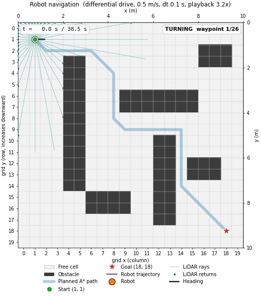

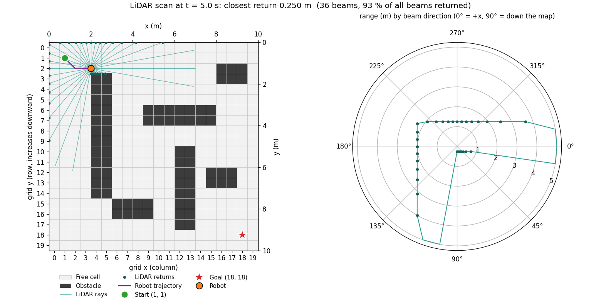

Every beam is traced cell by cell through the grid (Amanatides–Woo traversal), so the
range is the exact distance to the first obstacle face or map edge, and no obstacle can
be skipped. A 1 mm sampling approach missed a 0.66 mm sliver of an obstacle in testing;
the traversal cannot. Beams turn with the robot, and `lidar_scans.csv` records every
beam of every scan. `lidar_scan.png` shows the scan with the closest return. It costs
about 75 ns per ray (2.2 ms for 72 beams × 386 scans). Details:
[docs/algorithms.md](docs/algorithms.md#12-simulated-2d-lidar---lidar-beams-n).

The animated GIF above uses `--fps 10 --dpi 70` to keep its size down. With many beams,
GIFs get large (5 MB at 72 beams with the defaults), because the rays change many
pixels every frame.

### EKF localization

```bash
python3 python/run_demo.py --map maps/obstacles.csv --start 1 1 --goal 18 18 \
    --connectivity 8 --robot-model diff-drive --lidar-beams 36 --ekf --save-gif
```

```text
EKF estimate:   position error RMS 0.005 m, max 0.019 m, final 0.000 m; heading RMS 0.11 deg
Dead reckoning: position error RMS 0.580 m, max 1.359 m, final 1.359 m; heading RMS 6.96 deg
EKF updates:    12647 beams fused, 36 rejected by the 3.0-sigma gate, mean NEES 0.58 (3 = consistent)
```

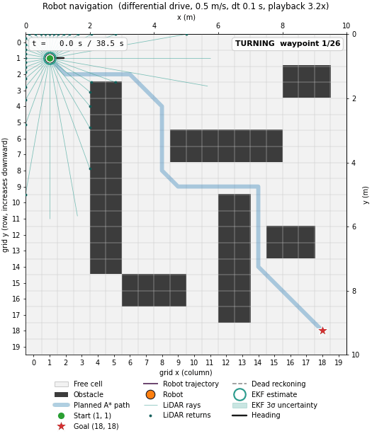

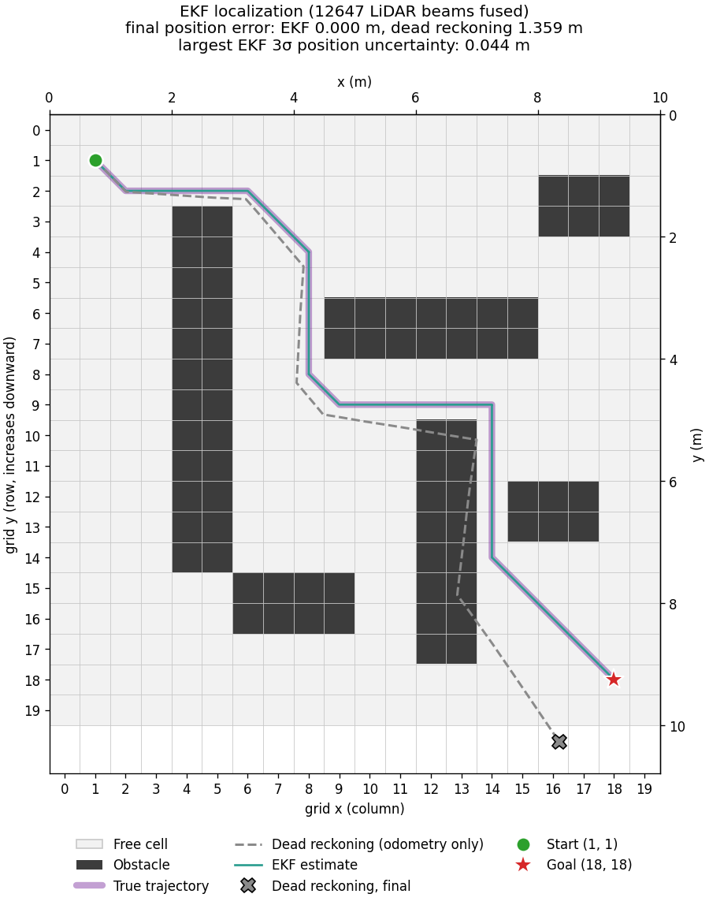

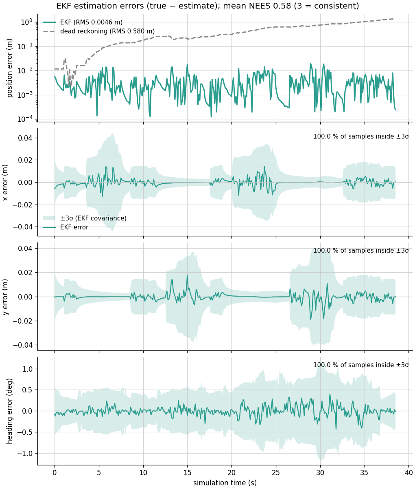

The robot's wheel odometry is simulated with errors that grow with distance driven and
angle turned. Integrated on its own (dead reckoning, dashed grey) it drifts more than a
metre over the route. The EKF predicts with the same odometry and corrects with every
LiDAR scan. It casts the expected range of each beam on the known map, uses the exact
derivative of that range with respect to the pose, and rejects beams whose mismatch is
implausible (for example, a beam that just missed an obstacle edge). The estimate stays
within 2 cm of the truth.

The filter is checked for honesty, not just accuracy. Over many runs its normalized
estimation error squared (NEES) averages 3.2 without the LiDAR and 3.2 with 5 cm range
noise; 3 is ideal. The 0.58 above is cautious on purpose, because the filter assumes
5 cm range noise and the default LiDAR is exact (set `--ekf-range-sigma` to the actual
noise). Getting there exposed a subtle modelling error, described with the method in
[docs/algorithms.md](docs/algorithms.md#13-ekf-localization---ekf). The EKF costs about
0.1 µs per beam. The robot is still steered by its true pose, so the EKF only observes.

### Dynamic obstacles and replanning

```bash
python3 python/run_demo.py --map maps/obstacles.csv --start 1 1 --goal 18 18 \
    --dynamic-obstacles maps/obstacles_dynamic.csv --save-gif
```

```text
Navigation:     GOAL_REACHED
Dynamic:        3 moving obstacle(s), sensing range 3.00 m; 3 replan(s) in 0.009 ms, 9.5 s waiting, closest gap 0.486 m
```

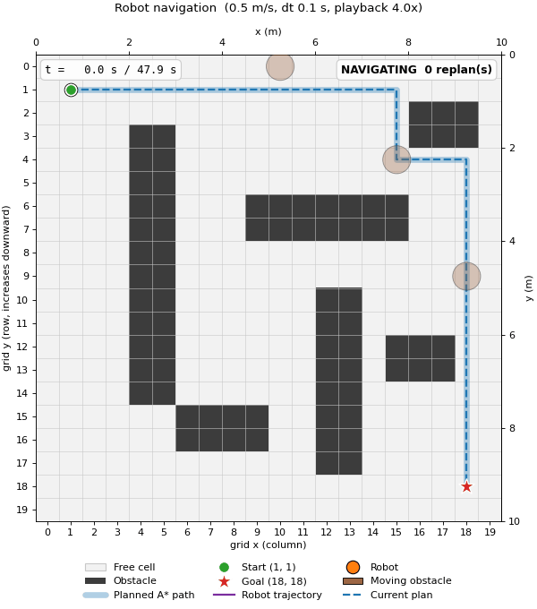

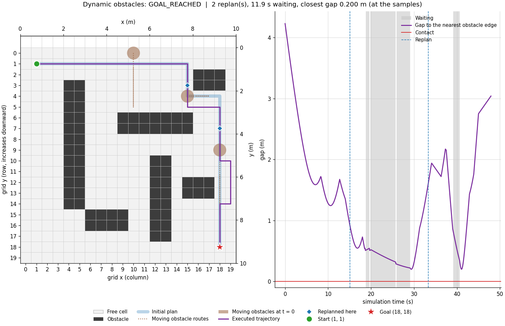

Three obstacles move back and forth: one crosses the top corridor, one dawdles across
the corner, and one patrols the right-hand lane. The robot only sees them within 3 m
and in line of sight. It estimates their velocities and treats the cells they are about
to sweep as blocked. When its path is blocked it waits up to 6 s for the way to clear,
then replans with A*. The same `AStarPlanner` object serves every replan, reusing its
buffers. Before each step it checks that it will not meet an obstacle within the next
2 s, so it crosses behind a moving obstacle rather than in front of it.

On 500 random scenarios with three moving obstacles each, the robot reaches the goal in
98.2 % (point) and 98.8 % (differential drive) of the runs, against 71 % for a robot that
does not react. The point robot never collided; the differential drive collided in
2 runs. Most of the remaining runs time out safely, waiting for a passage an obstacle
keeps blocking. Each rule of the method came from a failure found in testing; see
[docs/algorithms.md](docs/algorithms.md#14-dynamic-obstacles-and-replanning---dynamic-obstacles-file).

### Why NO_PATH? Minimum ghost cells

```bash
./build/ghost_experiment example --seed 23 --density 0.08 --output docs/ghost   # one map
./build/ghost_experiment recovery --trials 300 --output docs/ghost             # perception loop
./build/ghost_experiment recovery --trials 300 --cover-radius 4 --label sparse --output docs/ghost
./build/ghost_experiment scaling --trials 100 --output docs/ghost              # solver study
python3 python/plot_ghost_experiment.py                                         # -> docs/images/ghost_*.png
```

When the disc-robot planner says `NO_PATH`, it doesn't say why. The robot's footprint
inflates every obstacle into a rounded square, and these squares overlap, so removing
one obstacle may free nothing. `findGhostCells` (`include/ghost_cells.hpp`) finds,
exactly, the smallest set of occupied cells whose removal would open a path. It can
also find the most likely set, when each cell has a confidence, and it lists every
optimal alternative:

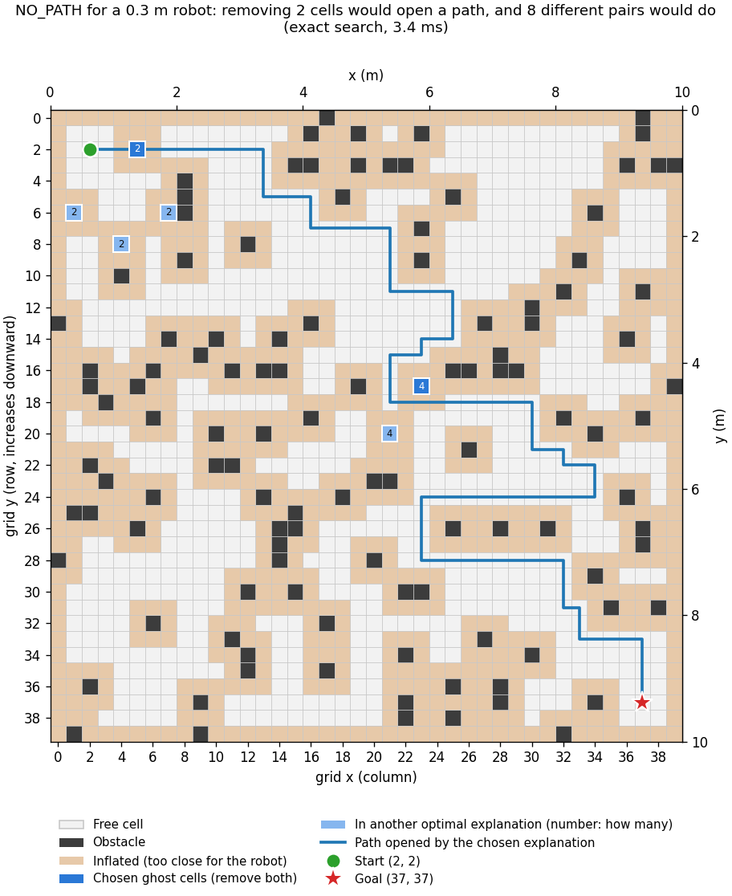

This is minimum constraint removal, NP-hard in general; the lattice version with
identical footprints appears unstudied and its complexity is open.

- **Correctness:** the solver equals brute force on thousands of random maps, and it
  reproduces a 400-map brute-force study exactly in 8.6 s instead of 1 min 44 s.
- **Speed:** it solves typical cases in milliseconds. The cost grows steeply with the
  size of the explanation (up to about a minute for 9–13 cells):

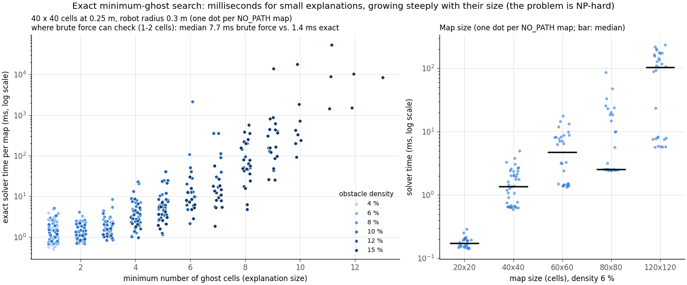

**Closing the perception loop.** A simulated LiDAR maps a world containing *ghost
sources*: reflections that return false hits only to beams from certain directions.
They are persistent, so clearing the map and scanning again brings them back. When the
belief map has `NO_PATH`, the robot:

1. explains it with the most likely ghost set;
2. drives to look at only those cells from a different direction;
3. decides each cell with a two-hypothesis test (a beam can pass through a ghost, but
   never through a wall);
4. replans.

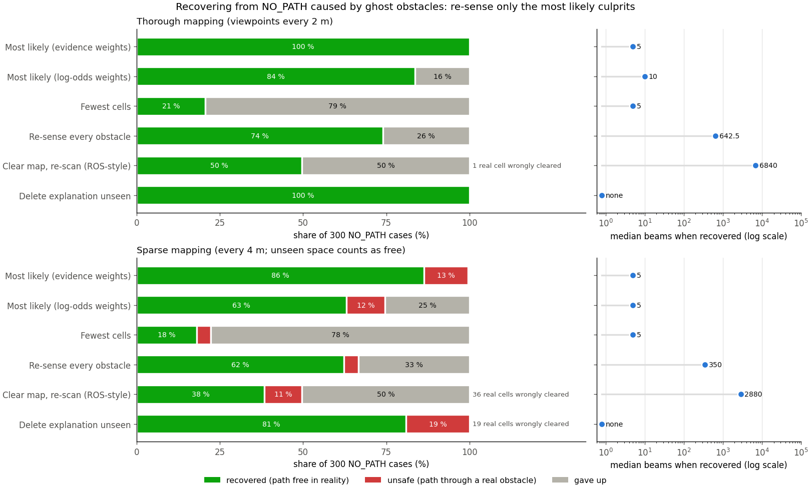

On 300 ghost-caused failures it recovered every one, with a median of 5 beams, and it
never wrongly cleared a real obstacle. Clearing the map (the ROS-style recovery)
recovered half the cases, using thousands of beams. Deleting the suspects without
looking was fast, but under sparse mapping it opened paths through 19 real obstacles.
Method, results and what went wrong along the way:
[docs/algorithms.md](docs/algorithms.md#15-why-no_path-minimum-ghost-cells-and-targeted-re-sensing-ghost_experiment).

### Grid alignment: the same doorway, passable or not

```bash
./build/alignment_experiment example --output docs/alignment               # the figure below
./build/alignment_experiment doorway --trials 60 --output docs/alignment   # width sweep
./build/alignment_experiment clutter --trials 100 --output docs/alignment  # random rooms
./build/alignment_experiment classify --trials 60 --output docs/alignment  # artifact vs ghost
python3 python/plot_alignment_experiment.py                                 # -> docs/images/alignment_*.png
```

An occupancy grid rounds obstacles to whole cells, and the planner checks the robot's
footprint only at cell centres. So whether a door is passable can depend on nothing but
where the grid happened to start:

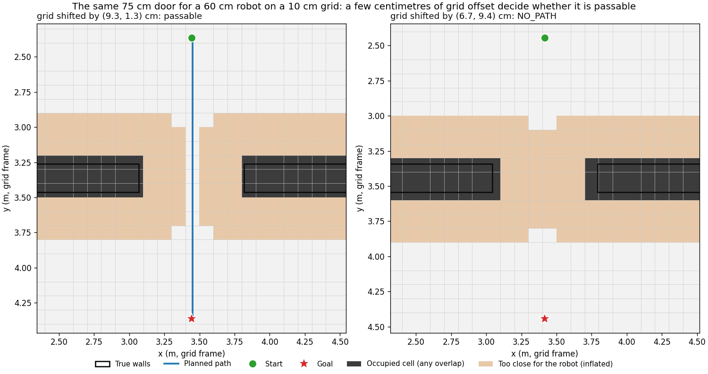

Across 60 random rotations and offsets per door width, with 0.1 m cells and a 0.6 m
robot, every rasterization rule leaves a band of about 25 cm of door widths where the
answer is a coin toss. With the conservative "any overlap" rule (the costmap default),
a door 25 cm wider than the robot passes for only half of the alignments. The bounds
are proven in the docs:
- it is never unsafe;
- it always passes once the door is 3√2 cells wider than the robot;
- on an axis-aligned grid it needs 7 whole free cells.

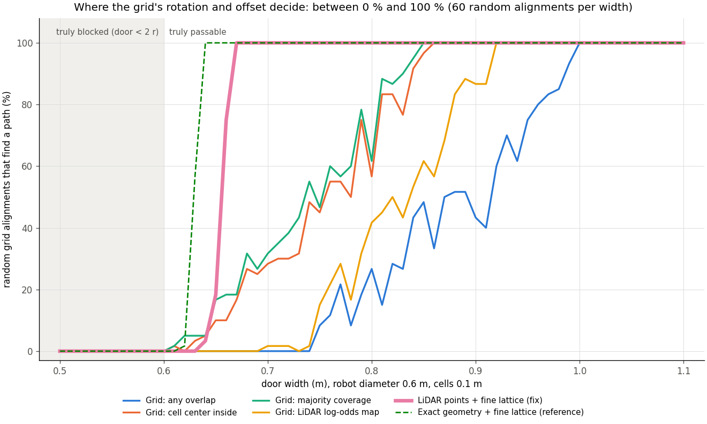

**The fix** plans on the LiDAR's hit points instead of the grid's cells: exact clearance
on a fine lattice. Three safeguards, each found from an unsafe case in testing, keep it
safe:
- joining nearby hits into surfaces;
- a margin where a surface may continue between two beams;
- keeping clear of space the LiDAR never observed.

The band shrinks from about 25 cm to 3 cm, and in 100 random cluttered rooms the answer
changed with the grid in 5 rooms instead of 22–29, never unsafely.

**Artifact or ghost?** Problem 1 judged ghosts by beams passing through a *cell*. But a
cell on a wall's edge is partly free, so beams pass through it as well as hit it, and
the grid-only recovery took real wall cells for ghosts:

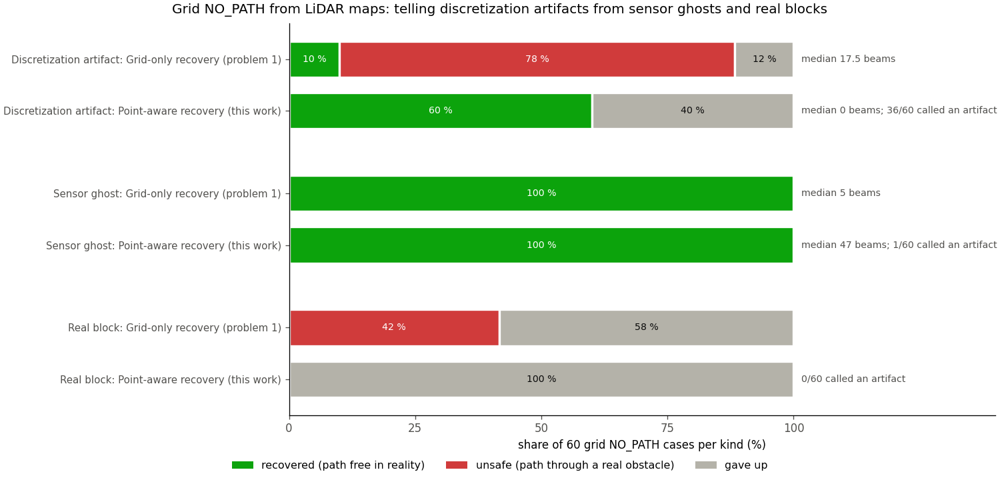

The point-aware recovery first plans on the points. A path there means the grid's
NO_PATH was a discretization artifact, needing no sensing. Otherwise it re-senses with
point-level evidence: a hit is contradicted only by a beam passing within 5 mm of it.

On 60 grid NO_PATH cases of each kind:
- **Grid-only recovery** opened unsafe paths through walls in 47 of 60 artifact cases
  and 25 of 60 truly blocked doors.
- **Point-aware recovery** was never unsafe. It recognised 36 artifacts without
  sensing, which was every one outside its 3–4 cm tolerance band. It cleared all 60
  ghosts and refused all 60 real blocks.
Details, numbers and the safety fixes:
[docs/algorithms.md](docs/algorithms.md#16-grid-alignment-when-the-same-doorway-is-passable-or-not-alignment_experiment).

### P vs. PID heading control

```bash
./build/heading_experiment                       # -> results/heading/*.csv + summary table
python3 python/plot_heading_control.py           # -> results/heading/*.png
./build/heading_experiment --sweep               # the PID gain grid behind the default gains
```

The study compares P (`Kp = 4`) and PID (`Kp = 4, Ki = 2, Kd = 0.4`) on a robot heading
whose motor follows commands with a 0.25 s lag, in four scenarios:

- a 90° step;
- a 90° step with a constant 0.3 rad/s disturbance (wheel slip);
- following an arc (a ramp);
- the heading profile of a planned path.

| | P | PID |
|---|---|---|
| 90° step: overshoot / settling time | 7.3 % / 2.08 s | 5.4 % / 2.52 s |
| with disturbance: settling / steady-state error | never / −4.3° | 3.55 s / −0.05° |
| arc (ramp): steady-state lag / IAE | 7.2° / 1.25 rad·s | 0.04° / 0.35 rad·s |
| planned path: IAE / control effort | 4.24 rad·s / 10.5 rad | 4.49 rad·s / 8.9 rad |

| Step with a disturbance | All metrics |
|---|---|
| 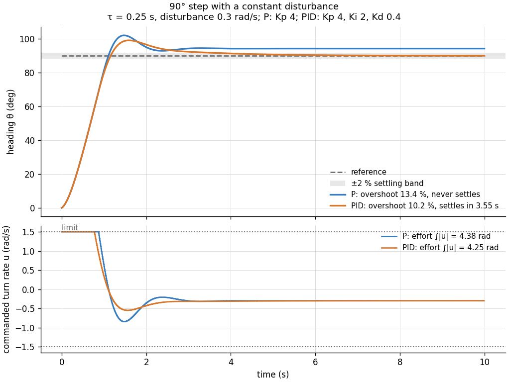 | 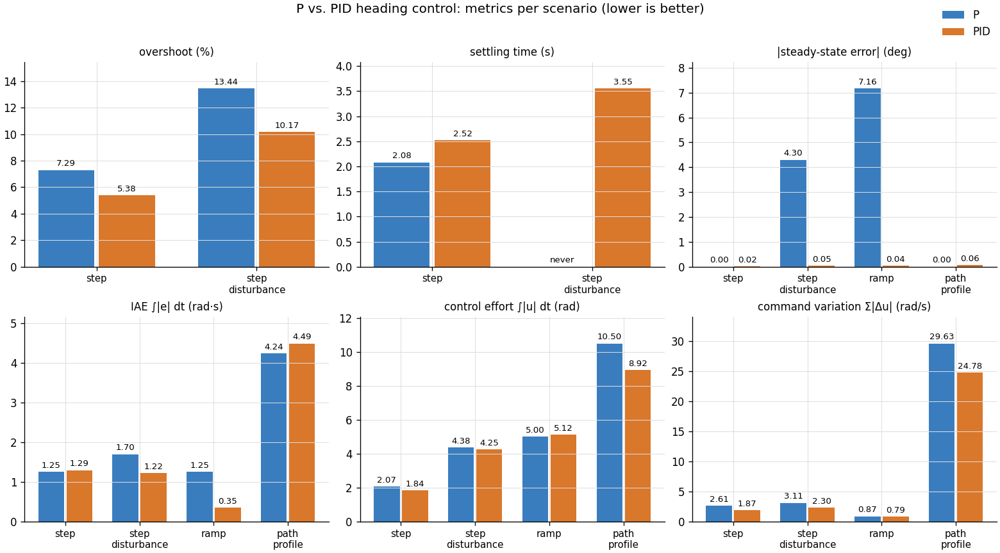 |

PID is the only one of the two that removes a persistent heading error, whether from a
disturbance or from following a curve. It also overshoots less and uses less control
effort. P settles a little faster on a clean step and tracks frequent steps marginally
better. The simulation is validated against theory: P's overshoot matches the
closed-form second-order value within 0.2 percentage points, and its steady-state errors
equal `d/Kp` and `rate/Kp`. Full analysis:
[docs/algorithms.md](docs/algorithms.md#11-p-vs-pid-heading-control-heading_experiment).

### Differential-drive robot

```bash
python3 python/run_demo.py --map maps/obstacles.csv --start 1 1 --goal 18 18 \
    --connectivity 8 --robot-model diff-drive --save-gif
```

```text
Navigation:     GOAL_REACHED
Motion:         385 steps of 0.10 s at 0.50 m/s, travel time 38.50 s, distance 14.66 m
Heading:        differential drive, 8 turns in place, 8.50 s turning, total rotation 7.07 rad, final heading 45.00 deg
```

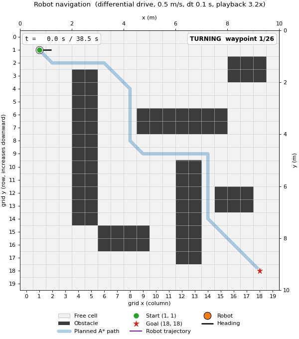

| Trajectory with heading arrows | Position and heading vs. time |
|---|---|
| 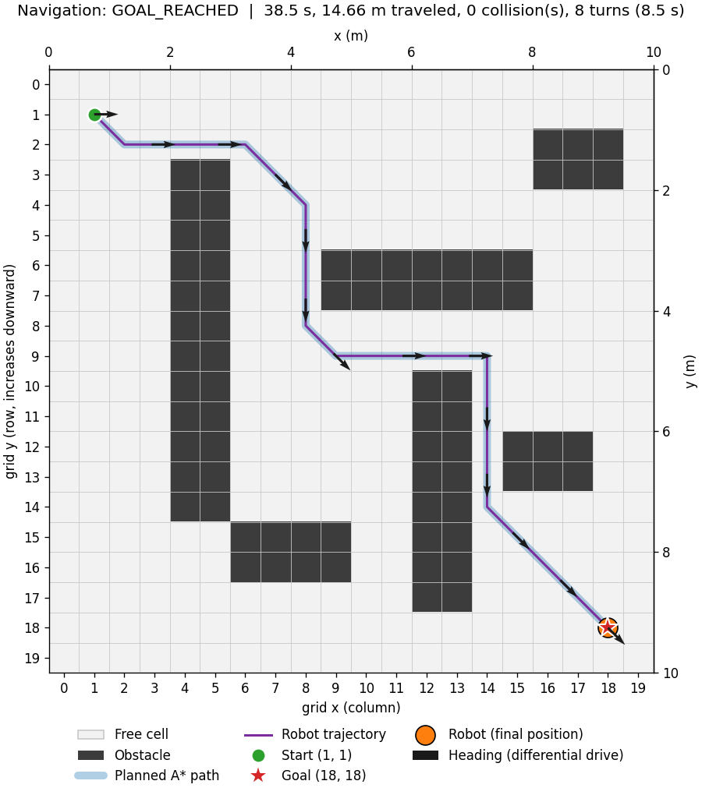 | 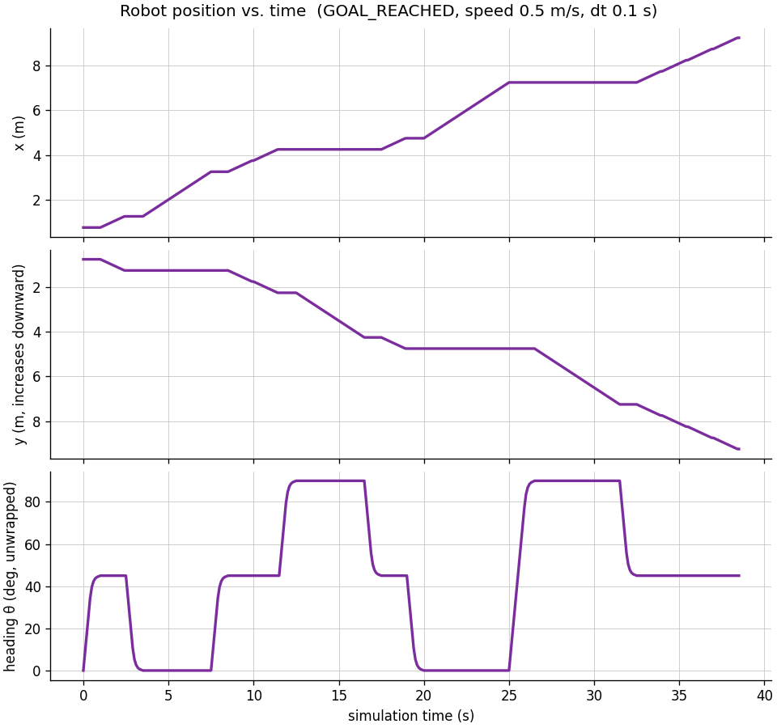 |

The robot has a heading `θ` and is driven by a linear velocity `v ≤ --speed` and an
angular velocity `|ω| ≤ --max-angular-speed`. At each waypoint where the path changes
direction, it **turns in place** under a proportional heading controller: saturated at
the turn-rate limit, then an exponential approach, then an exact final step, with no
overshoot. Then it **drives straight** to the next waypoint. Its center therefore stays
exactly on the planned path, so the footprint and corner-cutting guarantees still hold.

Turning costs time. On the obstacles map, the 8-connected path is 14 % shorter than the
4-connected one but has 8 turns instead of 3, so both take 38.5 s. In the maze, 14 turns
add 21 s to a 60 s drive. Details and measurements:
[docs/algorithms.md](docs/algorithms.md#10-differential-drive-robot---robot-model-diff-drive).

### 8-connected planning

```bash
./build/robot_simulator --map maps/obstacles.csv --start 1 1 --goal 18 18 \
    --connectivity 8 --reference-bfs
```

```text
Path:           27 waypoints, 26 steps (8 diagonal), 14.66 m
Reference:      exact Dijkstra, 29.313708 cells (matches A*)
Navigation:     GOAL_REACHED
```

| 4-connected (default): 17.00 m | 8-connected: 14.66 m |
|---|---|
|  | 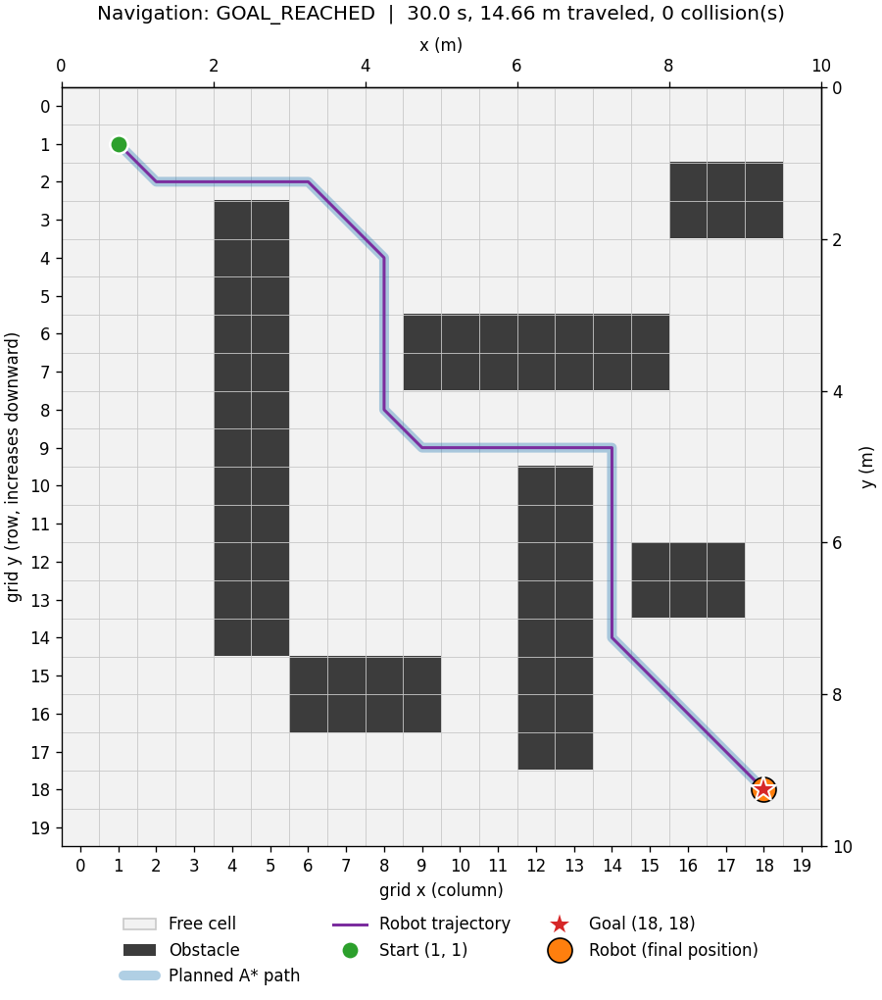 |

A diagonal move is only allowed when both cells beside it are free, so paths never cut
across an obstacle corner. In narrow corridors such as `maps/maze.csv`, this leaves no
diagonals at all. `--connectivity 8` combines with `--robot-radius`, and the footprint
guarantee also holds for diagonal moves. Over 480 benchmark maps, 8-connected paths are
29.3 % shorter on empty maps and 12 % shorter at 30 % obstacles. Planning is 2–8× slower,
but still a median of 0.6 ms on a 100 × 100 map
([details](docs/performance.md#4--vs-8-connectivity)).

### Robot footprint

```bash
python3 python/run_demo.py --map maps/obstacles_fine.csv --resolution 0.25 \
    --start 20 2 --goal 20 37 --robot-radius 0.2 --save-gif
```

```text
Footprint:      radius 0.200 m, 372 cells inflated (0.067 ms)
Planner status: SUCCESS
Path:           46 waypoints, 45 steps, 11.25 m
Navigation:     GOAL_REACHED
```

| `--robot-radius 0.2` (45 steps) | `--robot-radius 0.4` (65 steps) |
|---|---|
| 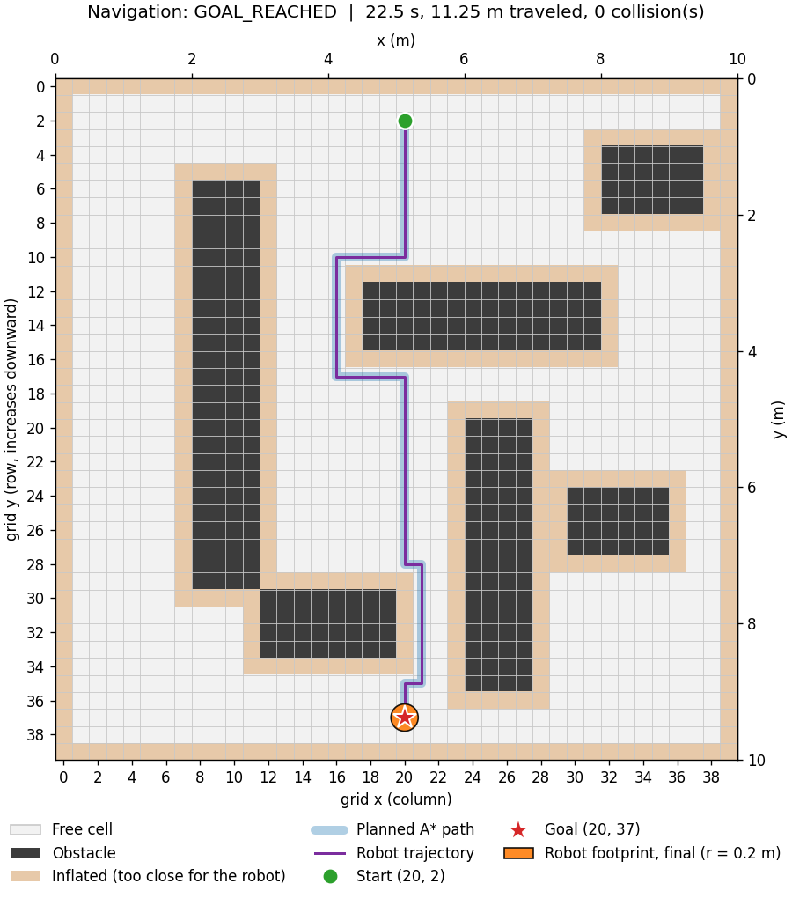 | 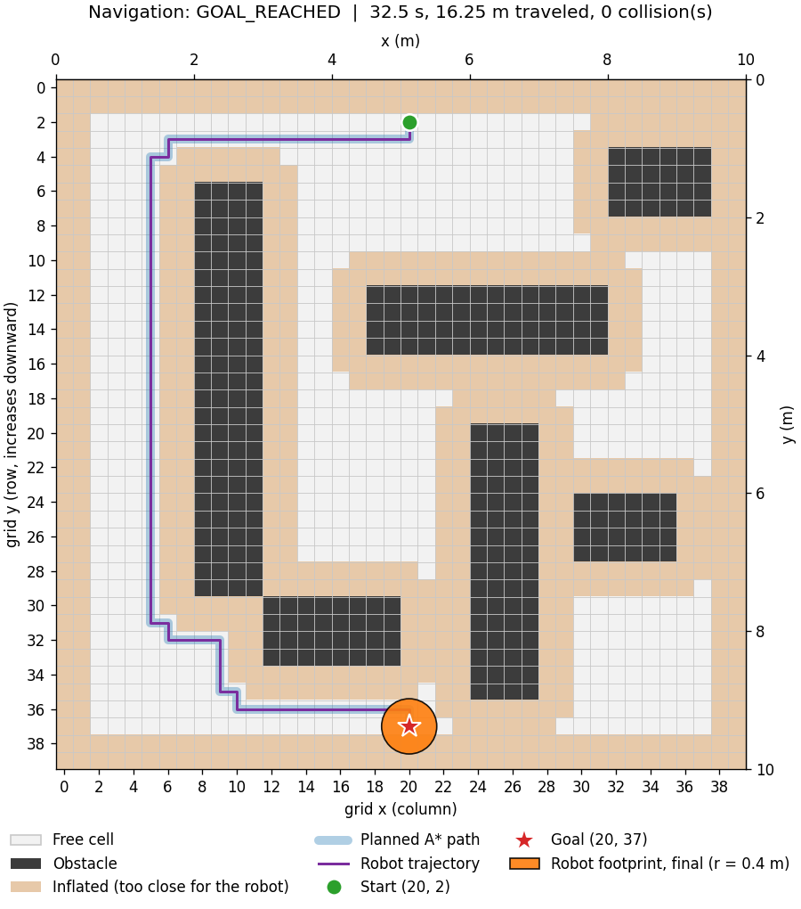 |

The shaded band marks cells where the robot's *center* may not go. The robot is drawn
at its true size. With `r = 0.4 m` (0.8 m wide) the robot no longer fits between the bars and
takes the long way round. A point robot needs 41 steps for the same trip. If the robot
cannot fit anywhere, the result is `NO_PATH`; if it cannot even stand at the start or
goal, the result is `START_TOO_CLOSE_TO_OBSTACLE` / `GOAL_TOO_CLOSE_TO_OBSTACLE`. Details,
including why inflation is safe and when it is conservative:
[docs/algorithms.md](docs/algorithms.md#8-robot-footprint-and-obstacle-inflation).

### ROS 2 and RViz2

The simulator also runs as ROS 2 nodes (tested on Humble). The standalone build
doesn't need ROS. The ROS 2 package builds into its own `build_ros2/` and
`install_ros2/` directories.

```bash
source /opt/ros/humble/setup.bash
scripts/build_ros2.sh --test
source install_ros2/setup.bash
ros2 launch robot_nav_sim_ros sim.launch.py robot_model:=diff-drive lidar_beams:=36 ekf:=true
```

RViz2 opens with the map, the inflated map, the plan, the trajectory, the odometry, the
scan, the EKF estimate with its covariance, and the moving obstacles. **2D Goal Pose**
sends a new goal and the robot replans from where it is. **2D Pose Estimate** moves the
robot. Frames follow REP 103 (`y` up, counter-clockwise yaw). The simulator's `y`-down
grid is converted at the boundary.

Topics, parameters, frame conversions and tests: [docs/ros2.md](docs/ros2.md).

### Generate maps

```bash
python3 python/generate_map.py --type maze --seed 3 --goal 19 19 --output maps/maze.csv
python3 python/generate_map.py --type random --width 40 --height 40 \
    --density 0.3 --seed 7 --ensure-reachable --output maps/random_40.csv
```

Types: `empty`, `obstacles`, `corridor`, `maze`, `random`. Random maps are reproducible
for a given `--seed`. A path is **not** guaranteed unless `--ensure-reachable` is used.

## File formats

**Map CSV**: one row per line, comma-separated `0` (free) / `1` (occupied). The first
line is row `y = 0`. Blank lines and lines starting with `#` are ignored.

**`path.csv`**: `waypoint_index,grid_x,grid_y,world_x,world_y`. Includes start and
goal. Header only when planning fails.

**`planning_metrics.csv`**: one row with
`status,success,map_width,map_height,resolution,start_x,start_y,goal_x,goal_y,planning_time_ms,expanded_nodes,waypoint_count,path_length_steps,path_length_m,reference_bfs_cost,robot_radius_m,inflation_time_ms,connectivity,diagonal_steps,path_cost_cells`.
`path_length_steps` counts moves; `path_cost_cells` is the path cost in cell units
(straight moves + diagonal moves × √2). The path fields are empty when planning fails.
`reference_bfs_cost` is empty unless `--reference-bfs` was given, and `-1` when the
reference search found no path. Otherwise it is an integer step count (BFS) for
4-connectivity, and a cost in cell units with 6 decimals (exact Dijkstra) for
8-connectivity.

**`lidar_scans.csv`** (only with `--lidar-beams` > 0): one row per beam and scan,
`time,beam,angle,range,hit`. `angle` is the world-frame beam direction in radians. `hit`
is `0` when the beam found nothing within the maximum range, which is then reported as
the range.

**`localization.csv`** (only with `--ekf`): one row per trajectory sample,
`time,true_x,true_y,true_theta,odom_x,odom_y,odom_theta,est_x,est_y,est_theta,var_x,cov_xy,var_y,cov_x_theta,cov_y_theta,var_theta,beams_used,beams_rejected,nees`.
`odom_*` is dead reckoning and `est_*` the EKF estimate (m, rad); the covariance entries
are in scientific notation; `nees` is `eᵀ P⁻¹ e` for the EKF error `e`.

**Dynamic obstacle file** (`--dynamic-obstacles`): one obstacle per line,
`radius_m,speed_mps,x0,y0,x1,y1[,x2,y2...]` with whole grid cells; the obstacle moves
back and forth along the route through their centres. `#` lines are comments. With it
the simulator writes:

- `dynamic_obstacles.csv`: `time,obstacle,x,y,radius,visible`, one row per obstacle and
  trajectory sample;
- `replans.csv`: `replan,time,from_x,from_y,status,waypoints,path_cost_cells,expanded_nodes,planning_time_ms,blocked_cells`,
  one row per replanning attempt;
- `replanned_paths.csv`: `replan,waypoint_index,grid_x,grid_y`, the new paths.

In `trajectory.csv`, `target_waypoint_index` then refers to the waypoint list as
extended by the replans.

**`inflated_map.csv`** (only with `--robot-radius` > 0): the map A* planned on, in the
same format as input maps.

**`trajectory.csv`**: `time,x,y,target_waypoint_index`. One row per timestep, from
`t = 0` (start-cell center) to the final position; `x`, `y` in meters.
`target_waypoint_index` is the waypoint the robot is heading to after that sample (the
last index once the goal is reached). With `--robot-model diff-drive` three columns
follow: `theta` (heading, rad), `linear_velocity` (m/s) and `angular_velocity` (rad/s),
where the velocities are those applied during the step that ended at the sample. Header
only when planning fails.

**`simulation_metrics.csv`**: one row with
`status,success,navigation_success,steps,travel_time_s,distance_traveled_m,final_goal_error_m,collision_count,speed_mps,dt_s,goal_tolerance_m,max_time_s,robot_radius_m,robot_model,turns,turn_time_s,total_rotation_rad,final_heading_rad`.
Travel time is the final timestamp minus the initial timestamp. The distance, time and
error fields are empty when the simulation did not run. `turns` through
`final_heading_rad` are filled for the differential-drive model only.

## Algorithm summary

A* expands cells in order of `f(n) = g(n) + h(n)`, where `g` is the number of steps from
the start and `h(n) = |x_goal − x_n| + |y_goal − y_n|`. The Manhattan heuristic never
overestimates the remaining cost on a 4-connected grid, so the first time the goal is
expanded its cost is optimal. Ties are broken by lowest `f`, then lowest `h`, then
lowest `y`, then lowest `x`, so results are reproducible.

The robot then follows the waypoints at constant speed. Each timestep it moves
`min(speed × dt, distance to the next waypoint)` toward that waypoint, so it never
overshoots, and every movement segment is checked against the occupancy grid. Full
explanation: [docs/algorithms.md](docs/algorithms.md).

## Performance

Measured on an AMD Ryzen 7 4800H laptop (Ubuntu 22.04 under WSL2, GCC 11.4, Release
build): 480 random maps from 10 × 10 to 100 × 100 cells with 0–30 % obstacles, 20 seeds
per configuration, start and goal in opposite corners.

| Metric | Result |
|---|---|
| A* optimal (cost equal to reference BFS) | 480 / 480 runs |
| Median planning time, 100 × 100, successful plans | 0.039 ms (0 % obstacles) to 0.085 ms (20 %) |
| Slowest single plan | 0.89 ms |
| Warm planning on 400 × 400 maps (`bench_planner`) | 0.037 ms (0 %) to 1.8 ms (30 %) |
| Expanded nodes, obstacle-free maps | exactly 2N − 1, the path cells only |
| Navigation success (all sizes) | 100 % / 95 % / 75 % / 53 % at 0 / 10 / 20 / 30 % obstacles |
| Collisions, timeouts | 0, 0 |

| | |
|---|---|
| 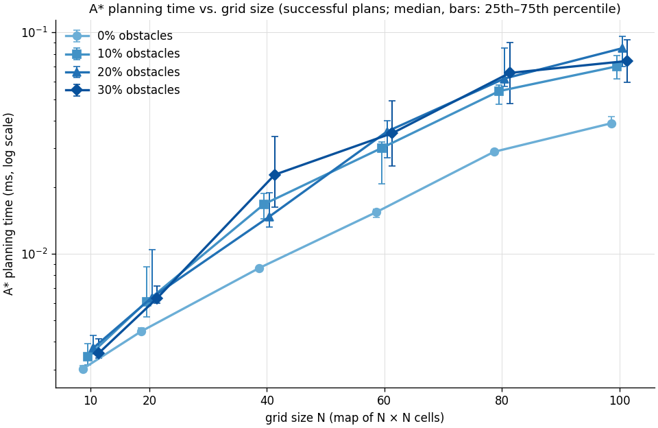 | 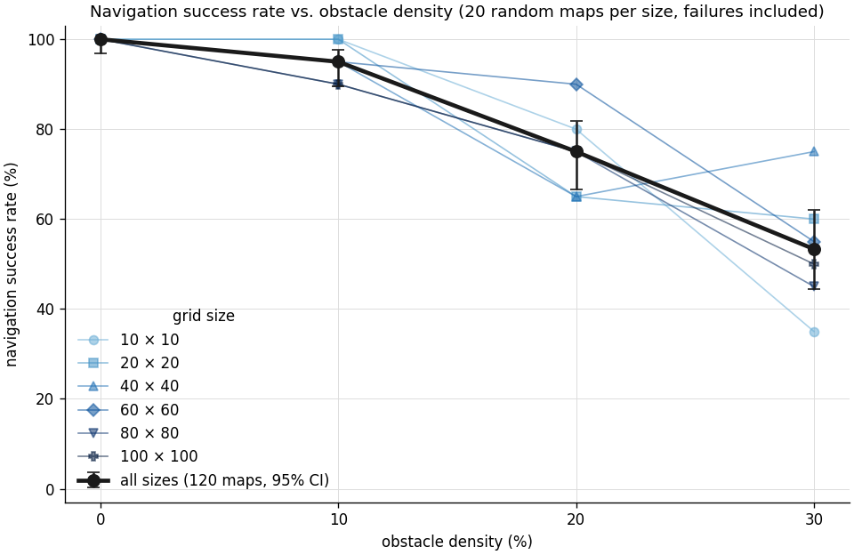 |

Failures are genuine `NO_PATH` results. 89 of the 92 come from a start or goal corner being sealed
off by its neighbors.

**Optimization.** Benchmarking showed the first planner spent most of its time setting
up per-cell arrays. The optimized planner stores one byte of state per cell, writes costs
only for cells it reaches, and uses a two-bucket open set: f only takes two values at a
time on this grid, so it needs two heaps of single-integer keys.

- **Planning:** 1.1–3.0× faster in-process and up to 2.5× faster per CLI call.
- **GIF/MP4 export:** blitted rendering cut GIF + MP4 export from 75 s to 11 s, and GIF
  alone from 25 s to 9 s.
- **Same results:** both produce bit-identical results, verified on 400 random maps and
  pixel-exact frame comparisons.

Methodology, all plots, the before/after tables and the measurement limitations are in
[docs/performance.md](docs/performance.md).

Reproduce:

```bash
python3 python/run_benchmark.py                        # 480 runs, about 10 s -> results/benchmark/
./build/bench_planner                                  # in-process micro-benchmark, about 7 s
python3 python/analyze_results.py run --results-dir results   # metrics of one run
```

To compare 4- and 8-connectivity on the same maps, run `run_benchmark.py` with each
`--connectivity` value and then `analyze_results.py compare` (see
[performance.md](docs/performance.md#4--vs-8-connectivity)).

## Testing

```bash
ctest --test-dir build --output-on-failure      # 50 CTest entries: C++ suites, CLI checks, Python suite
```

The ROS 2 package has 21 more tests (frame conversions, missions against the
standalone pipeline, and a launch test of both nodes). Run them with
`scripts/build_ros2.sh --test`.

[docs/testing.md](docs/testing.md) lists every test case and what it checks, plus the
mutation checks (deliberately broken code that the tests must catch) and the sanitizer
and static-analysis results.

## Project structure

```text
robot-nav-simulator/
├── CMakeLists.txt          build, tests (CTest) and benchmark targets
├── include/, src/          C++17 core: grid_map, astar, footprint, robot, diff_drive, simulator,
│                           heading_control, lidar, ekf, dynamic_obstacles, ghost_cells,
│                           ghost_perception, geometry2d, alignment, csv_writer, main (CLI),
│                           heading_experiment, ghost_experiment, alignment_experiment
├── tests/                  C++ unit tests, Python tests, test map fixtures (tests/data/)
├── benchmarks/             bench_planner.cpp (in-process planner micro-benchmark)
├── python/                 generate_map, visualize_map, animate_robot, run_demo,
│                           run_benchmark, analyze_results, plot_heading_control,
│                           plot_ghost_experiment, plot_alignment_experiment
├── maps/                   sample maps (empty, obstacles, corridor, maze, obstacles_fine) and
│                           moving obstacles for the obstacles map (obstacles_dynamic)
├── ros2/robot_nav_sim_ros/ optional ROS 2 package: map_server_node, simulator_node,
│                           frame conversions, launch file, RViz2 config, tests
├── cmake/                  amr_core_sources.cmake (core sources shared with the ROS 2 build)
├── scripts/                build.sh, test.sh, run.sh, build_ros2.sh
├── Dockerfile, docker-compose.yml, docker/   one image with everything; entrypoint and test runner
├── docs/                   architecture, algorithms, testing, performance, ros2, docker,
│                           benchmark data and images
└── results/                generated outputs (git-ignored)
```

## Known limitations

- The differential-drive model has turn-rate but no acceleration limits, and it stops to
  turn at every corner. The planner minimises path length, not travel time including
  turns.
- The footprint is a disc (no rectangular or oriented robots). Inflation is
  evaluated at cell centers, so on a coarse grid it can reject a passage the robot would
  physically fit through (safe, but conservative). Measured: with 0.1 m cells, doors up
  to 3√2 cells wider than the robot can be refused depending only on the grid's
  alignment. `alignment.hpp` shows the alignment-robust alternative on LiDAR points,
  which `robot_simulator` does not use yet.
- Leftover step distance is not carried over to the next waypoint. When `speed × dt`
  does not divide the cell size, the robot loses part of a timestep at every waypoint,
  so travel time is slightly longer than `path length / speed`.
- 4-connected movement only; paths are optimal in grid steps, not in Euclidean distance.
- Moving obstacles are avoided reactively, with constant-velocity prediction: obstacles
  that reverse, close in from two sides, or keep blocking the only passage can still
  cause a collision or a timeout (about 2 % of random scenarios).
- The ROS 2 simulator plays back precomputed missions. A new goal restarts from the
  center of the robot's current cell. It does not take `/cmd_vel` commands
  ([docs/ros2.md](docs/ros2.md#limitations)).
- GIF export of the default ~200-frame animation takes about 9 s, most of it Pillow's GIF
  encoding. Lower `--fps` or `--dpi` for faster exports.

## Troubleshooting

| Problem | Fix |
|---|---|
| `simulator not found at .../build/robot_simulator` | build first: `cmake -S . -B build && cmake --build build -j` |
| `ImportError: Matplotlib requires numpy>=...` | use the project environment: `source .venv/bin/activate` (system packages may be outdated) |
| CMake says "Python tests skipped" | create `.venv` and install `requirements.txt`, then re-run `cmake -S . -B build` |
| `--show` / `--animate` opens no window | no display is available (e.g. SSH); use `--save-gif` instead |
| `MP4 export needs FFmpeg` | `sudo apt install ffmpeg`, or use GIF export |
| `docker compose up sim`: RViz2 says `could not connect to display` | Linux: `xhost +local:docker`; WSL2: check that `echo $DISPLAY` is set ([docs/docker.md](docs/docker.md#rviz2-display)) |
| `ROS 2 is not sourced` from `scripts/build_ros2.sh` | `source /opt/ros/<distro>/setup.bash` first |
| RViz2 shows no scan | the scan uses sensor-data (best-effort) QoS; set the LaserScan display's reliability to Best Effort (the bundled config does) |
| `results were produced for a ... map` / `path crosses obstacles` | the CSV files in `results/` belong to another map; re-run the simulator with this map |

## Roadmap

| Phase | Scope | Status |
|---|---|---|
| 1 | Repository, CMake, map loading & validation, sample maps | ✅ done |
| 2 | A* planner, path export, planner tests | ✅ done |
| 3 | Point-robot motion simulation, collision checks, `trajectory.csv` | ✅ done |
| 4 | Robot animation, GIF/MP4 export, one-command demo | ✅ done |
| 5 | Benchmarks, performance analysis and plots | ✅ done |
| 6 | Optimization, verification, publication polish | ✅ done |

### Future improvements

- ✅ **Robot footprint:** disc robot with obstacle inflation (`--robot-radius`).
- ✅ **8-connected A*:** diagonal moves with an octile heuristic and no corner-cutting
  (`--connectivity 8`).
- ✅ **Differential-drive robot:** `x, y, θ` with linear and angular velocity and a
  waypoint-following controller (`--robot-model diff-drive`).
- ✅ **P vs. PID heading control:** compared on tracking error, overshoot, settling
  time and control effort (`heading_experiment`).
- **Realistic actuator in navigation:** use the lagged, disturbed heading plant and the
  PID controller inside the navigation simulator (with path-tracking error as a metric).
- **Turn-aware planning:** charge for turns so a differential-drive robot gets the
  fastest route, not just the shortest.
- ✅ **Simulated 2D LiDAR:** exact ray casting, scans every timestep, rays in the
  animation (`--lidar-beams`).
- ✅ **EKF localization:** noisy odometry, an EKF corrected by the LiDAR, estimated vs.
  true trajectory with error plots (`--ekf`).
- ✅ **Dynamic obstacles:** moving obstacles, blocked-path detection and replanning
  with the reused `AStarPlanner` (`--dynamic-obstacles`).
- ✅ **ROS 2 integration:** `map_server_node` and `simulator_node` publish the map,
  plan, pose, scan, EKF estimate and moving obstacles for RViz2, which can set goals and
  poses; the standalone simulator is unchanged ([docs/ros2.md](docs/ros2.md)). Open:
  `/cmd_vel` control so Nav2 can drive the robot.
- ✅ **Why NO_PATH?** the minimum ghost-cell explanation of a planning failure, and
  re-sensing only those cells (`ghost_experiment`). Open: the complexity of the lattice
  problem, and using the explanation live in `robot_simulator`.
- ✅ **Grid alignment:** doorways whose passability depends on the grid's rotation and
  offset, measured and bounded; an alignment-robust planner on LiDAR points; telling
  discretization artifacts from sensor ghosts (`alignment_experiment`). Open: using it
  in `robot_simulator`.

## License

MIT, see [LICENSE](LICENSE).
