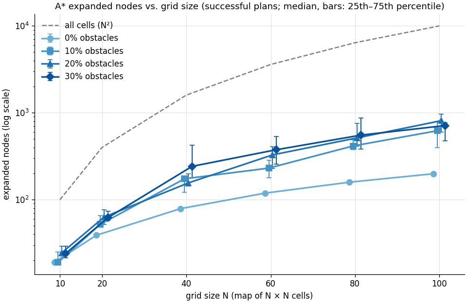
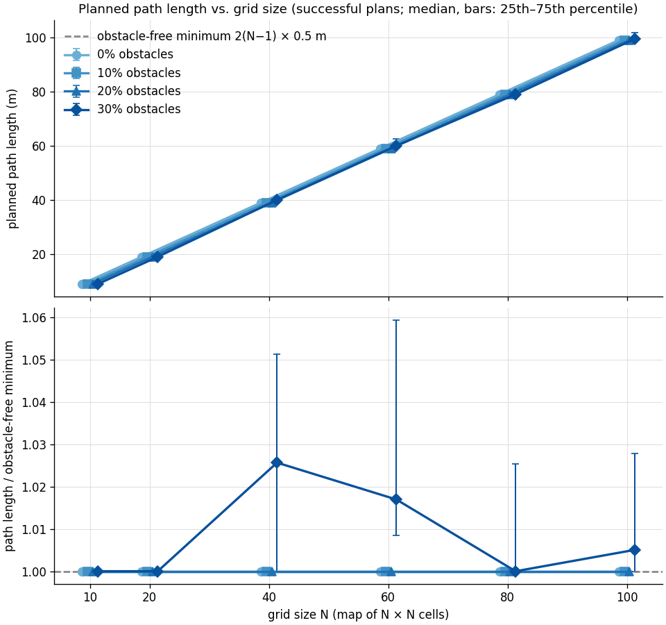
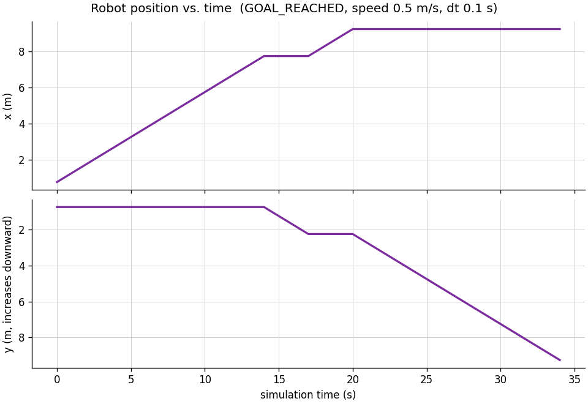
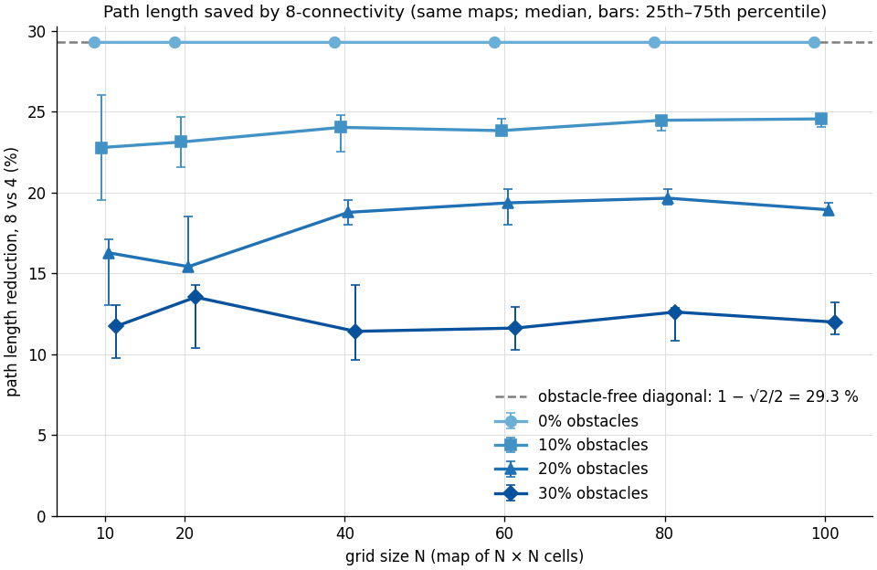

# Performance

This document describes how the planner and the navigation simulation were benchmarked,
what was measured, what the measurements show, and how the implementation was optimized.
Every number and figure here comes from measurements: the benchmark data in
[`docs/benchmark/`](benchmark/) and the micro-benchmark runs listed below. Nothing was
estimated or synthesized.

## How to reproduce

```bash
cmake -S . -B build && cmake --build build -j     # Release build (the default)
python3 python/run_benchmark.py                    # 480 runs, about 10 s
# -> results/benchmark/benchmark_runs.csv, benchmark_metadata.json,
#    benchmark_summary.csv/.md and the plots below
./build/bench_planner                              # in-process micro-benchmark, about 7 s
```

`python3 python/analyze_results.py benchmark` regenerates the summary and plots from an
existing `benchmark_runs.csv`. `python3 python/analyze_results.py run` analyzes a single
simulator run in `results/`.

## Methodology

Two complementary benchmarks:

| | `run_benchmark.py` (navigation benchmark) | `bench_planner` (micro-benchmark) |
|---|---|---|
| Measures | one cold planning call per `robot_simulator` process, plus the full navigation run | warm, repeated planning calls inside one process |
| Represents | what a single CLI invocation experiences | the steady-state cost of the planner itself |
| Maps | N = 10–100, 0–30 % obstacles, 20 seeds: 480 runs | N = 10–400, 0–30 % obstacles, 5 seeds per row |
| Statistic | median over seeds; the summary table also gives mean, min, max, p95 | median of 21–20 001 repeats per map, then median over the 5 maps |

### Navigation benchmark settings

| Item | Setting |
|---|---|
| Grid sizes N | 10, 20, 40, 60, 80, 100 (maps of N × N cells, 0.5 m per cell) |
| Obstacle densities | 0 %, 10 %, 20 %, 30 % (each cell occupied independently with that probability) |
| Seeds | 20 per (N, density): **480 runs** in total |
| Map seeding | `numpy.random.default_rng([seed, N, round(100·density)])`, so every map is reproducible |
| Start, goal | opposite corners `(0, 0)` → `(N−1, N−1)`; only these two cells are forced free |
| Reachability | **not** guaranteed; unreachable goals are recorded as failures, never discarded |
| Motion | 0.5 m/s, dt 0.1 s, goal tolerance 0.05 m, time limit 5000 s (raised from the CLI default of 600 s so long paths on large maps do not time out) |
| Optimality check | every run uses `--reference-bfs`: the C++ reference BFS cost is compared with the A* cost |
| Execution | one run at a time (no parallelism), each in a fresh `robot_simulator` process |

**What "planning time" measures.** `std::chrono::steady_clock` around the planner call
inside the C++ process: request validation, allocation and set-up of the search buffers,
and the search itself. It excludes process start-up, map loading, the BFS check, motion
simulation and file output.

**Navigation success** means planning succeeded *and* the robot reached the goal
within tolerance with no collision and no timeout. Every run counts in the success
rates, including failed ones.

### Test machine

| | |
|---|---|
| CPU | AMD Ryzen 7 4800H (16 logical CPUs) |
| OS | Ubuntu 22.04 under WSL2 (Linux 6.6.87.2-microsoft-standard-WSL2) |
| Compiler | GCC 11.4.0, CMake build type Release (`-O3`) |
| Python | 3.10.12, NumPy 2.2.6, Matplotlib 3.10.9 |
| Date | 2026-10-11 |

The data was collected with the optimized planner before it was committed, so
`benchmark_metadata.json` records the commit as `f8dcbf9-dirty`.

## Results

### Correctness

- **A* was optimal in 480 of 480 runs.** On all 388 reachable maps, its path cost equaled the reference
  BFS cost. On all 92 unreachable maps, both reported that no path exists.
- **0 collisions and 0 timeouts.** Navigation succeeded in exactly the runs where planning
  succeeded (388 of 480).
- For every successful run, the measured travel time equals `path length / speed`
  exactly. That is expected: with 0.05 m steps a 0.5 m cell takes exactly 10 steps (see
  [algorithms.md](algorithms.md#6-waypoint-tracking-point-robot-motion)).

### Planning time


Median over successful plans, one cold call per process (bars: 25th–75th percentile):

| N | 0 % | 10 % | 20 % | 30 % |
|---|---|---|---|---|
| 10 | 0.0030 ms | 0.0034 ms | 0.0037 ms | 0.0035 ms |
| 20 | 0.0045 ms | 0.0061 ms | 0.0063 ms | 0.0063 ms |
| 40 | 0.0086 ms | 0.0168 ms | 0.0147 ms | 0.0228 ms |
| 60 | 0.0154 ms | 0.0301 ms | 0.0357 ms | 0.0351 ms |
| 80 | 0.0289 ms | 0.0544 ms | 0.0619 ms | 0.0657 ms |
| 100 | 0.0389 ms | 0.0703 ms | 0.0849 ms | 0.0744 ms |
- Planning is fast for these map sizes. The slowest single run took 0.89 ms (N = 100,
  10 % density). The median is under 0.1 ms in every configuration.
- **The fixed set-up cost is now small.** Runs where the start or goal was sealed in,
  so the search expanded at most 5 nodes, measure the per-request set-up directly. At
  N = 100 they take a median of 0.0089 ms (under 1 ns per cell), down from 0.0975 ms
  before the optimization (see [below](#optimizations)). Search work now dominates.
- Obstacles make planning 1.7–2.7× slower than on an obstacle-free map of the same size (N ≥ 40),
  because the search has to explore around them (see expanded nodes below).
- In-process (warm) planning is faster still, and scales to larger maps. At N = 400 the
  median is 0.037 ms without obstacles and 0.45–1.77 ms with 10–30 % obstacles
  ([micro-benchmark table](#planner-micro-benchmark)).

### Expanded nodes



- **Obstacle-free maps: exactly 2N − 1 expansions** (19, 39, 79, …, 199). That is just
  the cells on the final path, thanks to the (f, h, y, x) tie-break (also asserted by
  test TC01).
- With obstacles, the median rises to 1.3–4.1× the 2N − 1 cells of a minimal path, but stays far
  below the N² cells of the map. At N = 100 the median is 622–812 nodes, 6–8 % of the 10 000
  cells.

### Path length



- **92 % of successful plans have the obstacle-free minimum length** `2(N − 1) × 0.5 m`.
  On a 4-connected grid, many different shortest paths exist between opposite corners, so
  random obstacles rarely force a detour.
- Only at 30 % density does the median detour become visible: 2.6 % (N = 40) and 1.7 % (N = 60).
  The largest detour over all 388 plans was 15 %.

### Navigation success rate


Pooled over all six grid sizes (120 maps per density; 95 % Wilson confidence interval):

| Density | Successful runs | Success rate | 95 % CI |
|---|---|---|---|
| 0 % | 120 / 120 | 100.0 % | 96.9–100.0 % |
| 10 % | 114 / 120 | 95.0 % | 89.5–97.7 % |
| 20 % | 90 / 120 | 75.0 % | 66.6–81.9 % |
| 30 % | 64 / 120 | 53.3 % | 44.4–62.0 % |

**Why runs fail.** All 92 failures are genuine `NO_PATH` results. Analyzing the failed
maps shows that **89 of 92 failures are caused by the start or the goal corner being sealed
into a small pocket** (median 2 free cells, at most 59). Only 3 maps were split into two
large regions. A corner cell has only two neighbors, so for density d the chance that both
neighbors of one corner are occupied is already d² (9 % at 30 %). Larger pockets add to
this. This is why the success rate depends mostly on the density and hardly on the grid size: the
per-size lines (20 maps each) scatter around the pooled line within their much larger
sampling uncertainty (about ±20 percentage points at n = 20).

### Robot motion (single run)



`maps/obstacles.csv`, (1, 1) → (18, 18): 34 grid steps, 17.0 m, 340 timesteps,
travel time 34.0 s, final goal error 0.0 m, 0 collisions. The sloped segments have a
constant 0.5 m/s slope. A flat segment in x(t) or y(t) means the robot is moving along the other
axis at that time.

## Optimizations

The Phase 5 measurements showed that a cold planning call was dominated by setting up
per-cell arrays, not by the search. Phase 6 reworked the planner and the animation
export. Each change was required to give **exactly the same results**, and this was checked
(see "Verification" below).

### What changed

| Area | Before | After | Why it helps |
|---|---|---|---|
| Per-cell search memory | `int` cost + `size_t` parent + `vector<bool>` closed, all initialized for every cell on every request (~12 bytes/cell) | one state byte per cell (visited, closed, parent direction) + a cost array that is only written for cells the search reaches | ~12× less memory to initialize and fault in per request |
| Open set | `std::priority_queue` of `(f, h, y, x)` structs | two binary heaps of packed 64-bit keys `(h << 32 \| index)`, one per f value | f only takes the values F and F + 2 (see [algorithms.md](algorithms.md)), and one integer comparison replaces a 4-field tuple comparison |
| Neighbor handling | coordinate structs, bounds and occupancy checks through `GridMap` methods | row-major index arithmetic on the raw occupancy array | fewer conversions in the hot loop |
| Repeated planning | new buffers per request | `AStarPlanner` reuses its buffers and resets only the cells the previous search touched | no O(N²) set-up per request when planning repeatedly |
| Trajectory | grows by reallocation | capacity reserved for the exact number of samples | no reallocation and copying during the simulation |
| GIF/MP4 export | every frame fully re-rendered, once per output file | blitting: static background drawn once, only changing artists redrawn; each frame rendered once and sent to every writer | about 20× less rendering work |

### Planner micro-benchmark

`bench_planner`, before (Phase 5 code) and after, built with the same compiler and
flags and run back to back. "Fresh" = `planAStar()`, new buffers per call; "reused" = one
`AStarPlanner` for all calls. Median microseconds per call:

| N | obstacles | expanded | before | after (fresh) | after (reused) | speed-up (fresh) |
|---|---|---|---|---|---|---|
| 20 | 20 % | 58 | 2.90 | 1.90 | 1.47 | 1.5× |
| 40 | 30 % | 1 016 | 86.50 | 29.18 | 25.56 | 3.0× |
| 100 | 0 % | 199 | 11.72 | 7.83 | 7.28 | 1.5× |
| 100 | 10 % | 730 | 63.70 | 26.25 | 25.15 | 2.4× |
| 100 | 20 % | 688 | 59.73 | 24.43 | 23.21 | 2.4× |
| 200 | 20 % | 2 525 | 267.90 | 144.90 | 142.60 | 1.8× |
| 400 | 0 % | 799 | 79.30 | 36.52 | 34.79 | 2.2× |
| 400 | 10 % | 8 397 | 895.75 | 446.98 | 441.82 | 2.0× |
| 400 | 30 % | 25 402 | 3 099.00 | 1 774.10 | 1 776.65 | 1.7× |

Over all 32 rows (N = 10–400, 0–30 %), the speed-up is 1.1–3.0×. Buffer reuse saves a
further 22–36 % of the time on 10 × 10 and 20 × 20 maps, where set-up is a large share of
a short search, and under 8 % for N ≥ 100.

### Navigation benchmark (cold single call)

The same 480 maps with the old and the new `robot_simulator`. Median planning time over
all runs of each grid size:

| N | before | after | speed-up |
|---|---|---|---|
| 10 | 0.0039 ms | 0.0034 ms | 1.1× |
| 20 | 0.0097 ms | 0.0058 ms | 1.7× |
| 40 | 0.0287 ms | 0.0144 ms | 2.0× |
| 60 | 0.0557 ms | 0.0257 ms | 2.2× |
| 80 | 0.1261 ms | 0.0502 ms | 2.5× |
| 100 | 0.1531 ms | 0.0636 ms | 2.4× |

### Animation export

`maps/obstacles.csv` run, 203 frames at 80 dpi:

| Export | Phase 4 first version | Phase 4 final | Phase 6 |
|---|---|---|---|
| GIF only | — | 24.8 s | 8.7 s (about 6 s of it is Pillow's GIF encoding) |
| GIF + MP4 | 175 s | 75 s | 10.8 s |

### Verification

- **Planner, micro-benchmark:** a checksum over every path, cost and expansion count of
  the 160 benchmark maps is identical before and after (`10413099435383803085`).
- **Planner, end to end:** `path.csv`, `trajectory.csv` and all non-timing planning
  metrics from the old and new binaries are byte-identical on 400 random maps (1–119
  cells per side, non-square, random start/goal, 0–45 % obstacles, all outcomes). All 480
  navigation-benchmark runs have identical non-timing columns.
- **Planner reuse:** the test suite plans 300 random maps of changing sizes with one
  `AStarPlanner` and compares every result with a fresh `planAStar()`. A version that
  skips the buffer reset fails this test.
- **Debug and sanitizer build:** the full test suite passes with AddressSanitizer and
  UndefinedBehaviorSanitizer, with the two-bucket invariant checked by an `assert`.
- **Animation:** the new GIF is byte-identical to the previous exporter's output, and
  the decoded MP4 frames are identical (same SHA-256). A test compares blitted frames
  with full renders pixel by pixel. A version that draws in the wrong z-order fails it.

## 4- vs 8-connectivity

The same 480 maps (same generator, seeds, start/goal corners and settings as above)
were planned twice with the current code: `--connectivity 4` and `--connectivity 8`.
Both runs used `--reference-bfs`, so each 8-connected plan was checked against the
exact Dijkstra reference. Data: [`benchmark/connectivity/`](benchmark/connectivity/).

```bash
python3 python/run_benchmark.py --connectivity 4 --output-dir results/bench4
python3 python/run_benchmark.py --connectivity 8 --output-dir results/bench8
python3 python/analyze_results.py compare --four results/bench4/benchmark_runs.csv \
    --eight results/bench8/benchmark_runs.csv --output-dir results/compare
```

**Correctness.**

- Both modes solved exactly the same 388 maps. As predicted, the no-corner-cutting rule
  leaves reachability unchanged.
- A* matched the exact reference in 480 of 480 runs in both modes.
- Both modes had 0 collisions.



**Path length.** By obstacle density, over the maps solved by both modes:

| Obstacles | Solved | Median path saving | Middle 50 % | Share of diagonal moves (median) |
|---|---|---|---|---|
| 0 % | 120 | 29.29 % | 29.29–29.29 % | 1.00 |
| 10 % | 114 | 24.10 % | 23.12–24.78 % | 0.70 |
| 20 % | 90 | 18.92 % | 17.47–19.65 % | 0.48 |
| 30 % | 64 | 11.93 % | 10.59–13.62 % | 0.27 |

- On obstacle-free maps the saving is exactly the theoretical `1 − √2/2 = 29.29 %` for a
  corner-to-corner trip.
- With more obstacles, the corner rule forbids more diagonals: at 30 % only a quarter of
  the moves are diagonal, so the saving shrinks.
- Over all 388 maps the median saving is 23.4 % (range 3.3–29.3 %). 8-connectivity was
  never longer.

**Planning cost.** Medians per grid size, one cold call per process:

| N | maps | solved (both) | median path 4-conn (m) | median path 8-conn (m) | median reduction | range | median ms 4 | median ms 8 | median expanded 4 | median expanded 8 |
|---|---|---|---|---|---|---|---|---|---|---|
| 10 | 80 | 63 | 9.0 | 6.95 | 22.78 % | 3.25–29.29 % | 0.0038 | 0.0089 | 19 | 18 |
| 20 | 80 | 65 | 19.0 | 14.607 | 23.12 % | 6.17–29.29 % | 0.0084 | 0.025 | 51 | 69 |
| 40 | 80 | 67 | 39.0 | 30.213 | 22.53 % | 7.32–29.29 % | 0.0178 | 0.0962 | 143 | 316 |
| 60 | 80 | 68 | 59.0 | 44.941 | 23.83 % | 9.61–29.29 % | 0.0344 | 0.2196 | 218 | 700 |
| 80 | 80 | 62 | 79.0 | 59.962 | 24.1 % | 10.62–29.29 % | 0.0625 | 0.3823 | 381 | 1164 |
| 100 | 80 | 63 | 99.0 | 74.69 | 24.56 % | 9.54–29.29 % | 0.0758 | 0.5979 | 497 | 1807 |

- **0 % obstacles:** 8-connectivity expands *fewer* nodes than 4-connectivity (0.51× the
  median), because its path has N instead of 2N − 1 cells. It is still about 2.3× slower,
  because every expansion costs more:
  - 8 neighbors instead of 4;
  - the corner checks;
  - exact cost comparisons;
  - a general priority queue instead of the specialised two-heap open set of the
    4-connected mode.
- **With obstacles:** it expands 1.9–2.6× more nodes, so it is 4.7–5.7× slower (median
  per density).
- **Absolute times:** 8-connected planning on these maps stays below 3 ms (slowest
  single plan: 2.66 ms, at N = 100).

**When to use which.** Use `--connectivity 8` when path quality matters: 12–29 % shorter
and more natural routes, for a median of 0.6 ms of planning on a 100 × 100 map. Use the
default 4-connectivity when raw planning speed matters most.

## Full summary (all runs)

Planning-time statistics here include **all** runs, failed searches too. That is why
some minimum times at high density are below the obstacle-free time: a sealed-in start
ends the search after one or two expansions. "nav. success" counts runs that reached the
goal. "A* = BFS" counts runs where A* and the reference BFS agreed.

| N | density | runs | nav. success | median ms | mean ms | min ms | max ms | p95 ms | median expanded | median path (m) | A* = BFS |
|---|---|---|---|---|---|---|---|---|---|---|---|
| 10 | 0% | 20 | 20/20 | 0.0030 | 0.0031 | 0.0029 | 0.0040 | 0.0038 | 19 | 9.0 | 20/20 |
| 10 | 10% | 20 | 20/20 | 0.0034 | 0.0035 | 0.0028 | 0.0043 | 0.0042 | 19 | 9.0 | 20/20 |
| 10 | 20% | 20 | 16/20 | 0.0038 | 0.0044 | 0.0014 | 0.0082 | 0.0080 | 25 | 9.0 | 20/20 |
| 10 | 30% | 20 | 7/20 | 0.0041 | 0.0041 | 0.0015 | 0.0067 | 0.0064 | 29 | 9.0 | 20/20 |
| 20 | 0% | 20 | 20/20 | 0.0045 | 0.0046 | 0.0042 | 0.0060 | 0.0049 | 39 | 19.0 | 20/20 |
| 20 | 10% | 20 | 20/20 | 0.0061 | 0.0071 | 0.0048 | 0.0106 | 0.0103 | 52 | 19.0 | 20/20 |
| 20 | 20% | 20 | 13/20 | 0.0063 | 0.0095 | 0.0014 | 0.0309 | 0.0257 | 60 | 19.0 | 20/20 |
| 20 | 30% | 20 | 12/20 | 0.0061 | 0.0072 | 0.0014 | 0.0242 | 0.0184 | 58 | 19.0 | 20/20 |
| 40 | 0% | 20 | 20/20 | 0.0086 | 0.0087 | 0.0082 | 0.0097 | 0.0096 | 79 | 39.0 | 20/20 |
| 40 | 10% | 20 | 19/20 | 0.0161 | 0.0163 | 0.0040 | 0.0258 | 0.0240 | 158 | 39.0 | 20/20 |
| 40 | 20% | 20 | 13/20 | 0.0144 | 0.0271 | 0.0035 | 0.1067 | 0.1067 | 154 | 39.0 | 20/20 |
| 40 | 30% | 20 | 15/20 | 0.0209 | 0.0324 | 0.0034 | 0.1191 | 0.0892 | 224 | 40.0 | 20/20 |
| 60 | 0% | 20 | 20/20 | 0.0154 | 0.0153 | 0.0137 | 0.0165 | 0.0164 | 119 | 59.0 | 20/20 |
| 60 | 10% | 20 | 19/20 | 0.0306 | 0.0414 | 0.0195 | 0.3047 | 0.0498 | 232 | 59.0 | 20/20 |
| 60 | 20% | 20 | 18/20 | 0.0353 | 0.0401 | 0.0038 | 0.2177 | 0.0564 | 284 | 59.0 | 20/20 |
| 60 | 30% | 20 | 11/20 | 0.0480 | 0.0843 | 0.0043 | 0.2137 | 0.2016 | 522 | 60.0 | 20/20 |
| 80 | 0% | 20 | 20/20 | 0.0289 | 0.0295 | 0.0273 | 0.0426 | 0.0311 | 159 | 79.0 | 20/20 |
| 80 | 10% | 20 | 18/20 | 0.0544 | 0.0767 | 0.0093 | 0.5428 | 0.1129 | 416 | 79.0 | 20/20 |
| 80 | 20% | 20 | 15/20 | 0.0631 | 0.1207 | 0.0038 | 0.4707 | 0.4598 | 539 | 79.0 | 20/20 |
| 80 | 30% | 20 | 9/20 | 0.0714 | 0.1604 | 0.0047 | 0.5116 | 0.4196 | 577 | 79.0 | 20/20 |
| 100 | 0% | 20 | 20/20 | 0.0389 | 0.0413 | 0.0374 | 0.0566 | 0.0543 | 199 | 99.0 | 20/20 |
| 100 | 10% | 20 | 18/20 | 0.0703 | 0.1105 | 0.0066 | 0.8926 | 0.1710 | 622 | 99.0 | 20/20 |
| 100 | 20% | 20 | 15/20 | 0.0845 | 0.1347 | 0.0104 | 0.7040 | 0.6998 | 791 | 99.0 | 20/20 |
| 100 | 30% | 20 | 10/20 | 0.0744 | 0.2069 | 0.0072 | 0.8428 | 0.5960 | 713 | 99.5 | 20/20 |

Raw per-run data: [`benchmark/benchmark_runs.csv`](benchmark/benchmark_runs.csv).
Machine and parameters: [`benchmark/benchmark_metadata.json`](benchmark/benchmark_metadata.json).

## Measurement limitations

- **Single cold call per run** (navigation benchmark). Each process plans once, so the
  time includes first-touch page faults and cold caches. On identical obstacle-free maps
  the spread was 0.0029–0.0040 ms (N = 10) and 0.0374–0.0566 ms (N = 100). Medians over 20
  runs are stable, but individual values can vary by tens of percent.
  `bench_planner` complements this with warm, repeated measurements.
- **Microsecond scale.** At N = 10 a plan takes about 1–4 µs, close to the overhead of
  reading the clock. Treat small-map timings as orders of magnitude, not exact values.
- **WSL2 virtual machine on a laptop.** CPU frequency scaling, the hypervisor and background
  processes add noise. Absolute times will differ on other machines; the trends
  (growth with N, effect of density) and before/after ratios are what carry over.
- **Benchmark design.** Corner start/goal and independent random obstacles make sealed-in
  corners the main failure mode. Other layouts (corridors, rooms, a start/goal
  in open space) would give different success rates.
- **Scope.** 4-connected moves and a point robot. No obstacle inflation, no dynamics.
